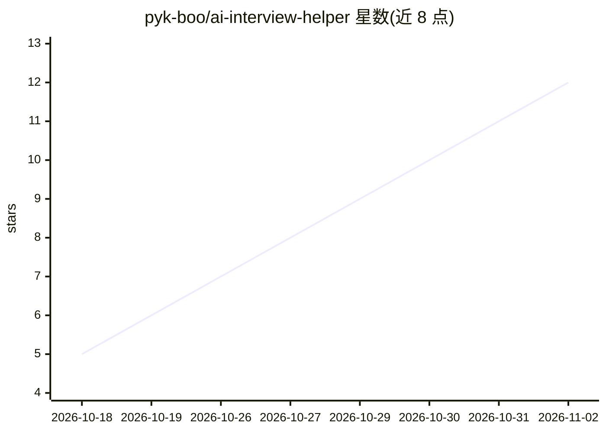

# pyk-boo/ai-interview-helper

⭐ 12 · JavaScript · MIT · 推送 2026-10-28 · [GitHub](https://github.com/pyk-boo/ai-interview-helper) · [官网](https://pyk-boo.github.io/ai-interview-helper/) · 个人维护

**开源 AI 面试助手：语音与截图实时生成答题**

Electron 桌面应用，站在求职者一侧的面试副驾驶：通过 Whisper（经 Groq/OpenAI 或 Gemini）实时转录面试官提问并自动生成回答，快捷键截图发给视觉模型解答编程题、SQL 与系统设计题；区分系统音频与麦克风以只回应面试官。支持 Groq、Claude、Gemini、GPT、DeepSeek、GLM 及本地 Ollama 七类提供方，API key 仅存本机、无后端。Windows 提供安装包与便携 exe，macOS/Linux 需从源码运行（Node.js 18+）。README 声明仅用于学习与模拟面试。

## 筛选速览

| 维度 | 判定 | 备注 |
|---|---|---|
| AI 角色 | `ai-native` | 本体是模型或模型工具 |
| 许可风险 | `permissive` | MIT |
| 部署形态 | `desktop` | 安装包/桌面程序 |
| 模型依赖 | local-ok | 支持本地模型 |
| 硬件要求 | — | 无带数字的原话,不猜 |
| 安装摩擦 | `low` | 无编译、无系统依赖或容器化 |
| 成熟度 | — | 结构信号不足 |

## 能力要点

- Whisper 实时语音转写并自动生成回答
- 快捷键截图交视觉模型解编程/SQL/系统设计题
- 7 个 AI 提供方可选，含本地 Ollama 离线运行
- API key 仅存本地，无遥测、无后端

## 适用场景

- 技术面试中实时听取提问并获得参考回答
- 对屏幕上的 LeetCode/HackerRank 题目截图求解
- 粘贴简历与目标岗位，生成第一人称个性化回答
- 用 Ollama 本地模型离线运行，零成本使用

## 场景标签

`AI 助手` · 领域:对话与助手

## 证据(README 行号)

> L21: **AI Interview Helper** is a free, open-source AI interview copilot (an AI assistant on the candidate's side, not a
> L42: |🎙 **Voice → answer**|Real-time speech-to-text (Whisper via Groq / OpenAI, or Gemini). Answers automatically when t

## 星数曲线

2026-10-18 5 → 2026-11-02 12（+7）

---
*卡片 v1 · prompt 1.4 · 生成 2026-11-01 · 置信度 high · 依据 README sha `2310698cd3f4` · [字段定义](../../DATASET.md)*
