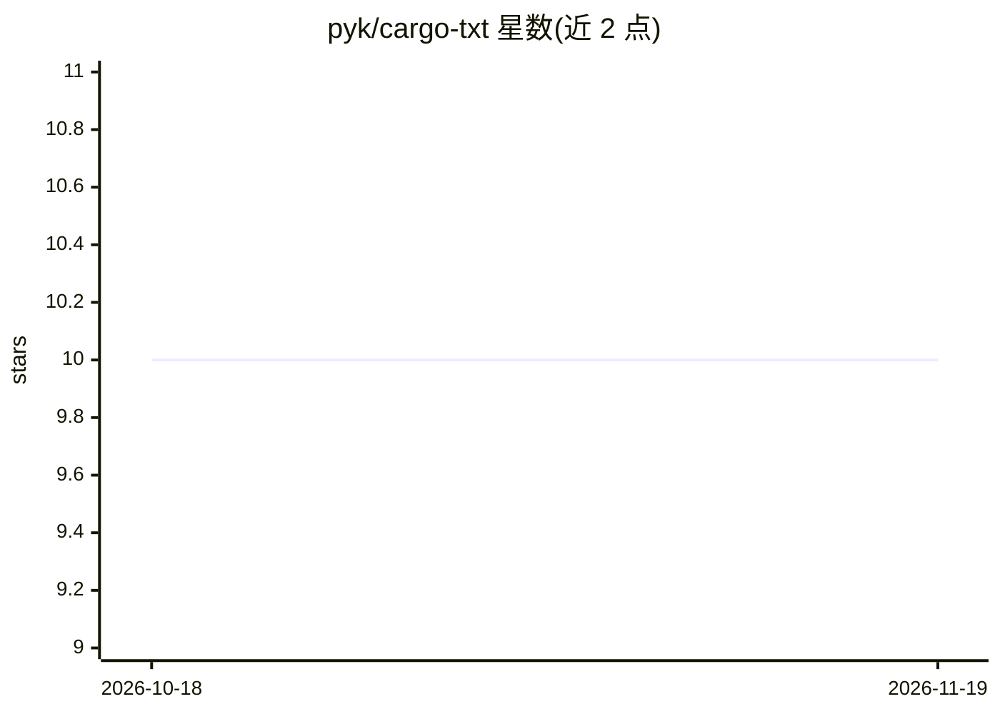

# pyk/cargo-txt

⭐ 10 · Rust · MIT · 推送 2026-05-18 · [GitHub](https://github.com/pyk/cargo-txt) · 个人维护

**供 LLM/编码 Agent 本地读取 Rust crate 文档的 cargo 子命令**

cargo-txt 是一个 cargo 子命令，供 LLM 与编码 Agent 在本地访问 crate 文档：用 stable cargo doc 生成 HTML 后转换为 markdown，写入 target/docmd 目录，并提供 build/list/show 三个命令分别构建文档、列出条目、按条目路径查看文档，条目级浏览可减少 token 用量。README 声明处于早期开发阶段；限制包括只能构建 Cargo.toml 中已列出的依赖，dev-dependency/build-dependency 无法直接构建。MIT 许可，通过 cargo install 安装。

## 筛选速览

| 维度 | 判定 | 备注 |
|---|---|---|
| AI 角色 | `ai-ecosystem` | LLM/agent 周边工具 |
| 许可风险 | `permissive` | MIT |
| 部署形态 | `library` | 以包/库形式分发 |
| 模型依赖 | — | README 未给出锁定关系 |
| 硬件要求 | — | 无带数字的原话,不猜 |
| 安装摩擦 | `low` | 无编译、无系统依赖或容器化 |
| 成熟度 | `idea` | |

## 能力要点

- 将 cargo doc 生成的 HTML 转换为 markdown 供 Agent 读取
- build/list/show 三个子命令支持条目级浏览以减少 token 用量
- metadata.json 提供条目映射，支持快速查找
- 仅覆盖 Cargo.toml 中的已安装依赖，不支持任意 crates.io crate

## 适用场景

- 让编码 Agent 读取本地最新的 crate 文档以替代训练数据中的过时信息
- 在对话式开发中按条目查看特定 trait/struct 的文档
- 减少把文档全量塞入上下文导致的 token 消耗

## 场景标签

`文档解析` · 领域:知识与检索

## 证据(README 行号)

> L19: `cargo-txt` is a cargo subcommand that your LLM or Coding Agents can use to
> L53: hallucination. It converts `cargo doc` HTML to markdown so agents can access
> L62: - Simple command-line interface for coding agents.

## 星数曲线

2026-10-18 10 → 2026-11-19 10（+0）

---
*卡片 v1 · prompt 1.4 · 生成 2026-11-19 · 置信度 high · 依据 README sha `7dd3ececfde0` · [字段定义](../../DATASET.md)*
