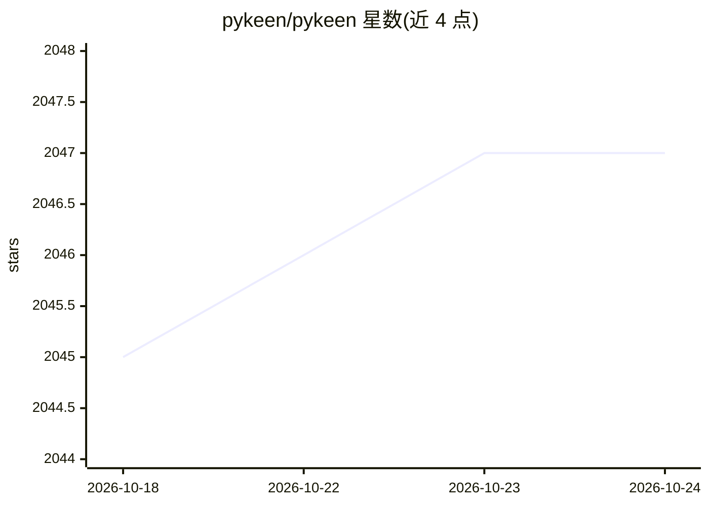

# pykeen/pykeen

⭐ 2,047 · Python · MIT · 推送 2026-10-23 · [GitHub](https://github.com/pykeen/pykeen) · [官网](https://pykeen.readthedocs.io/en/stable/) · 组织维护

**知识图谱嵌入模型的训练与评测 Python 库**

PyKEEN 是用于训练和评测知识图谱嵌入模型（支持多模态信息）的 Python 包，面向知识图谱补全与链接预测研究。内置 37 个数据集（另含 5 个归纳式数据集）、40 个模型、34 种交互函数与 22 种表示方法，统一 API 可互换。提供 pipeline 高级入口，默认使用 sLCWA 训练方式与基于排名的评测；集成 Optuna 超参优化与 PyTorch Lightning。要求 Python 3.11+，经 PyPI 安装。

## 筛选速览

| 维度 | 判定 | 备注 |
|---|---|---|
| AI 角色 | `ai-native` | 本体是模型或模型工具 |
| 许可风险 | `permissive` | MIT |
| 部署形态 | `library` | 以包/库形式分发 |
| 模型依赖 | — | README 未给出锁定关系 |
| 硬件要求 | — | 无带数字的原话,不猜 |
| 安装摩擦 | `low` | 无编译、无系统依赖或容器化 |
| 成熟度 | — | 结构信号不足 |

## 能力要点

- 内置 37 个数据集与 40 个知识图谱嵌入模型
- pipeline() 高级入口统一训练、评测与结果管理
- 22 种节点表示方法（含 NodePiece、R-GCN、文本/视觉编码）
- 集成 Optuna 超参优化与 PyTorch Lightning

## 适用场景

- 在标准数据集上训练 TransE/ComplEx 等链接预测模型
- 用统一 API 对比多种知识图谱嵌入方法
- 使用自带数据集（含生物医学 KG）做知识图谱补全实验

## 场景标签

`知识图谱` · 领域:知识与检索

## 证据(README 行号)

> L32:  PyKEEN ( P ython K nowl E dge E mbeddi N gs) is a Python package designed to
> L68: The following example shows how to train and evaluate the TransE

## 星数曲线

2026-10-18 2,045 → 2026-10-24 2,047（+2）

---
*卡片 v1 · prompt 1.4 · 生成 2026-10-21 · 置信度 high · 依据 README sha `b0b12da56996` · [字段定义](../../DATASET.md)*
