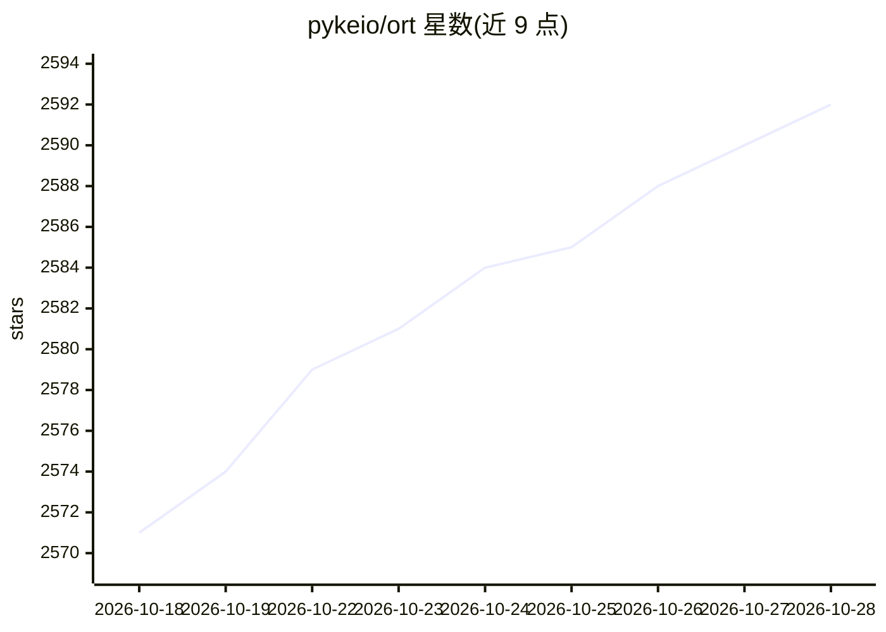

# pykeio/ort

⭐ 2,594 · Rust · Apache-2.0 · 推送 2026-10-25 · [GitHub](https://github.com/pykeio/ort) · [官网](https://ort.pyke.io/) · 组织维护

**Rust 的 ONNX Runtime 封装库：运行与训练 ONNX 模型**

Rust 语言访问 ONNX Runtime 的接口库，支持对 ONNX 格式机器学习模型执行硬件加速的推理与训练，并可选用其他纯 Rust 运行时作为后端。项目基于已停止维护的 onnxruntime-rs crate，由 pykeio 团队维护，提供指南、API 参考与示例文档。README 列出 TEI、Magika、FastEmbed-rs 等多个使用该库的下游项目，覆盖嵌入、OCR、语音识别、目标检测等场景。

## 筛选速览

| 维度 | 判定 | 备注 |
|---|---|---|
| AI 角色 | `ai-ecosystem` | LLM/agent 周边工具 |
| 许可风险 | `permissive` | Apache-2.0 |
| 部署形态 | `None` |  |
| 模型依赖 | — | README 未给出锁定关系 |
| 硬件要求 | — | 无带数字的原话,不猜 |
| 安装摩擦 | `low` | 无编译、无系统依赖或容器化 |
| 成熟度 | — | 结构信号不足 |

## 能力要点

- 封装 Microsoft ONNX Runtime，支持硬件加速推理与训练
- 支持其他纯 Rust ONNX 运行时作为后端
- 可运行由 PyTorch/TensorFlow/Keras/scikit-learn/PaddlePaddle 导出的模型

## 适用场景

- 在 Rust 应用中部署 ONNX 模型的推理或训练
- 在设备端或数据中心运行深度学习模型
- 为嵌入、OCR、目标检测等 Rust 工具提供推理后端

## 场景标签

`推理引擎` · 领域:训练与推理

## 证据(README 行号)

> L5: `ort` is a Rust interface for performing hardware-accelerated inference & training on machine learning models in the
> L7: Based on the now-inactive `onnxruntime-rs` crate, `ort` is primarily a wrapper for Microsoft's ONNX Runtime library,

## 星数曲线

2026-10-18 2,571 → 2026-10-28 2,592（+21）

---
*卡片 v1 · prompt 1.4 · 生成 2026-10-21 · 置信度 high · 依据 README sha `5e61cf9efa51` · [字段定义](../../DATASET.md)*
