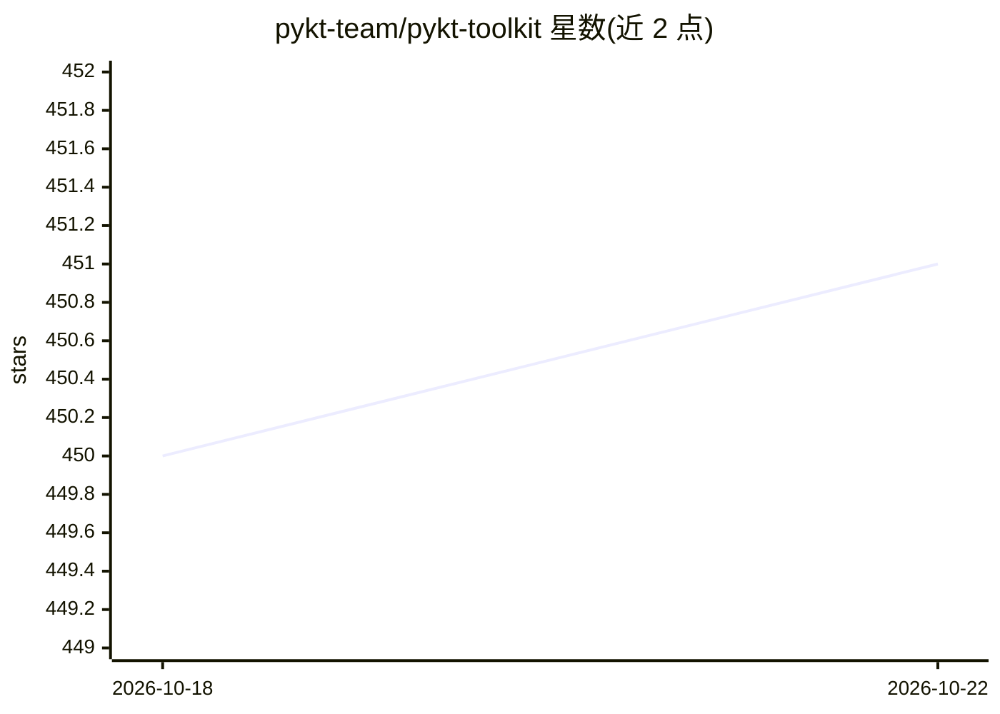

# pykt-team/pykt-toolkit

⭐ 451 · Python · MIT · 推送 2026-10-18 · [GitHub](https://github.com/pykt-team/pykt-toolkit) · [官网](https://pykt.org) · 组织维护

**基于 PyTorch 的深度知识追踪模型基准测试库**

pyKT 是基于 PyTorch 构建的 Python 库，用于训练深度学习知识追踪（DLKT）模型并做基准实验。内置覆盖不同领域的 7 个以上常用数据集的标准化数据预处理流程、5 种预测场景、10 余种常用 DLKT 模型实现（DKT、GKT、SAKT、AKT、simpleKT 等，参考列表含 32 篇论文对应方法）。面向教育数据挖掘研究者，提供全部模型在各数据集上的超参数调优结果下载，配有文档与网站。以 pip 包（Python 3.7.5 conda 环境）安装。

## 筛选速览

| 维度 | 判定 | 备注 |
|---|---|---|
| AI 角色 | `ai-native` | 本体是模型或模型工具 |
| 许可风险 | `permissive` | MIT |
| 部署形态 | `library` | 以包/库形式分发 |
| 模型依赖 | — | README 未给出锁定关系 |
| 硬件要求 | — | 无带数字的原话,不猜 |
| 安装摩擦 | `low` | 无编译、无系统依赖或容器化 |
| 成熟度 | — | 结构信号不足 |

## 能力要点

- 内置 7 个以上数据集的标准化预处理流程
- 5 种预测场景与 10 余种 DLKT 模型实现
- 提供全部模型超参数调优实验结果
- 附 NeurIPS 2022 Datasets and Benchmarks Track 论文

## 适用场景

- 我想统一基准对比多种知识追踪模型
- 在标准数据集上复现 DLKT 实验结果
- 为新的知识追踪方法找可比基线与调参参考

## 场景标签

 · 领域:教育数据挖掘/知识追踪

## 证据(README 行号)

> L7: pyKT is a python library build upon PyTorch to train deep learning based knowledge tracing models. The library consi

## 星数曲线

2026-10-18 450 → 2026-10-22 451（+1）

---
*卡片 v1 · prompt 1.4 · 生成 2026-10-21 · 置信度 high · 依据 README sha `17984819fe1a` · [字段定义](../../DATASET.md)*
