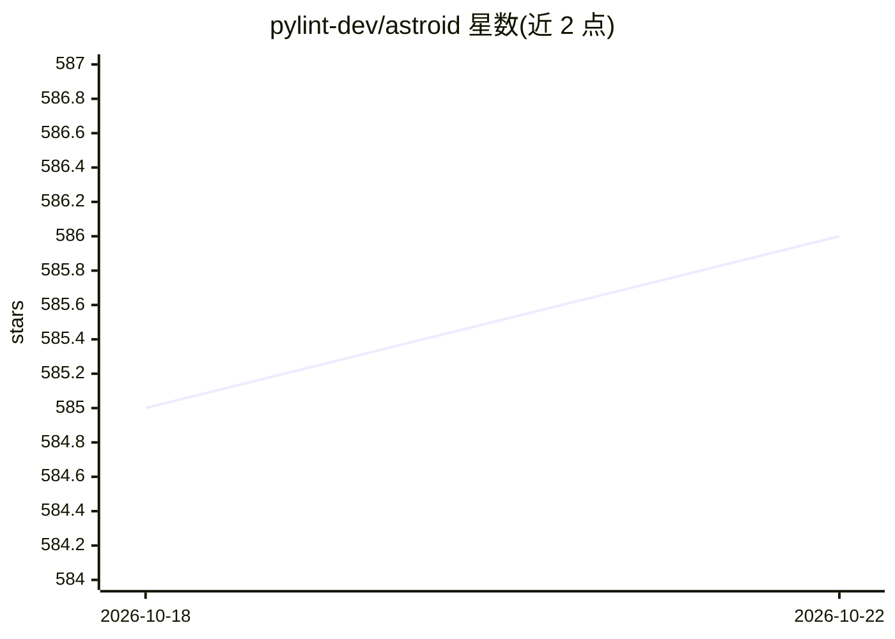

# pylint-dev/astroid

⭐ 586 · Python · LGPL-2.1 · 推送 2026-10-22 · [GitHub](https://github.com/pylint-dev/astroid) · [官网](https://pylint.readthedocs.io/projects/astroid/en/latest/) · 组织维护

**Python 源码通用 AST 表示库，pylint 的底层引擎**

提供 Python 源代码的统一基础表示：基于内置 _ast 模块重建扩展 AST，节点类附带额外方法与属性，支持静态推断（static inference）与局部名称作用域，还能通过检查存活对象构建部分树。当前是驱动 pylint 能力的库，供静态分析工具开发者在解析与推断层面复用。仅支持 Python 3（astroid 2.0 起），从源码目录 pip install 安装，文档托管于 readthedocs。

## 筛选速览

| 维度 | 判定 | 备注 |
|---|---|---|
| AI 角色 | `ai-enhanced` | 去掉 AI 部分产品仍成立 |
| 许可风险 | `viral` | LGPL-2.1 |
| 部署形态 | `library` | 以包/库形式分发 |
| 模型依赖 | — | README 未给出锁定关系 |
| 硬件要求 | — | 无带数字的原话,不猜 |
| 安装摩擦 | `low` | 无编译、无系统依赖或容器化 |
| 成熟度 | — | 结构信号不足 |

## 能力要点

- 重建内置 _ast 生成的树并扩展节点类的方法与属性
- 包含静态推断与局部名称作用域支持
- 可通过检查存活对象构建部分树
- 作为 pylint 的底层解析与推断引擎

## 适用场景

- 为静态分析工具提供 Python AST 的扩展表示
- 在 lint 工具中做静态类型/值推断
- 需要部分 AST 而无法获取完整源码时检查运行中对象

## 场景标签

 · 领域:软件开发/静态分析

## 证据(README 行号)

> L36: The aim of this module is to provide a common base representation of
> L43: usages. They include some support for static inference and local name
> L44: scopes. Furthermore, astroid can also build partial trees by inspecting living

## 星数曲线

2026-10-18 585 → 2026-10-22 586（+1）

---
*卡片 v1 · prompt 1.4 · 生成 2026-10-21 · 置信度 low · 依据 README sha `a3b8ed9f44f4` · [字段定义](../../DATASET.md)*
