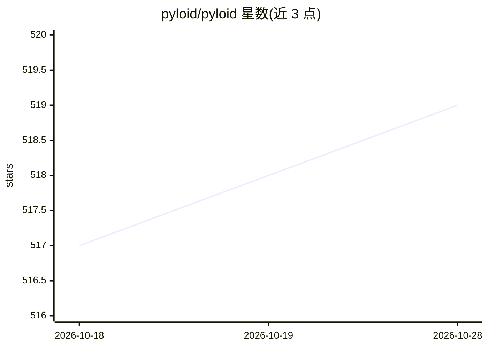

# pyloid/pyloid

⭐ 519 · Python · Apache-2.0 · 推送 2025-11-08 · [GitHub](https://github.com/pyloid/pyloid) · [官网](https://pyloid.com/) · 个人维护

**面向 Python 开发者的 Web 技术桌面应用框架**

Pyloid 是一个基于 Web 技术的 Python 桌面应用开发框架，定位描述为 'Electron for Python Developer'。支持任意前端框架与任意后端框架，覆盖 Windows/macOS/Linux 跨平台。内置 Builder、Server、Tray、Store、Timer、Monitor、Optimizer 等工具，声明实现了桌面应用所需的完整功能。通过 npm create pyloid-app 脚手架创建项目，采用 Apache License 2.0 许可，提供 Discord 社区与独立文档站点，并围绕主库维护 pyloid-builder、pyloid-adapter、pyloid-js 等多个子仓库。

## 筛选速览

| 维度 | 判定 | 备注 |
|---|---|---|
| AI 角色 | `ai-enhanced` | 去掉 AI 部分产品仍成立 |
| 许可风险 | `permissive` | Apache-2.0 |
| 部署形态 | `None` |  |
| 模型依赖 | — | README 未给出锁定关系 |
| 硬件要求 | — | 无带数字的原话,不猜 |
| 安装摩擦 | `low` | 无编译、无系统依赖或容器化 |
| 成熟度 | — | 结构信号不足 |

## 能力要点

- 支持任意前端与后端框架
- 跨平台支持（Windows/macOS/Linux）
- 内置 Builder、Server、Tray、Store、Timer、Monitor、Optimizer 等工具
- npm 脚手架 create-pyloid-app 创建项目

## 适用场景

- 用 Python 和熟悉的 Web 前端技术栈开发桌面应用
- 需要托盘、本地存储、内嵌服务器等桌面能力的跨平台应用
- 从 Electron 类技术栈迁移到 Python 后端的桌面开发

## 场景标签

 · 领域:桌面应用开发框架

## 证据(README 行号)

> L5:  Pyloid: Electron for Python Developer • Modern Web-based desktop app framework
> L12: - **Cross-Platform Support** (Windows, macOS, Linux)

## 星数曲线

2026-10-18 517 → 2026-10-28 519（+2）

---
*卡片 v1 · prompt 1.4 · 生成 2026-10-21 · 置信度 mid · 依据 README sha `c1e684195cc9` · [字段定义](../../DATASET.md)*
