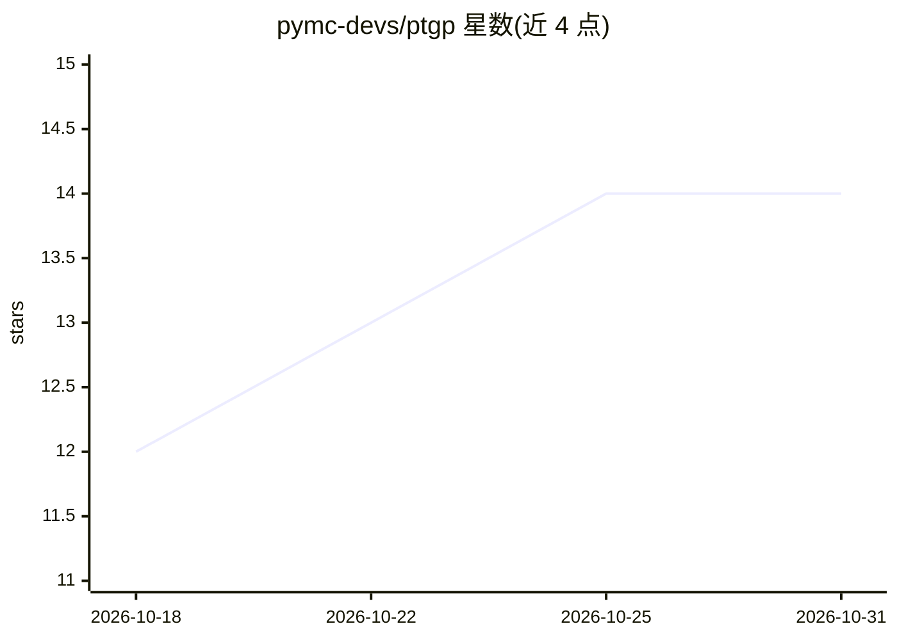

# pymc-devs/ptgp

⭐ 14 · Jupyter Notebook · MIT · 推送 2026-10-30 · [GitHub](https://github.com/pymc-devs/ptgp) · 组织维护

**基于 PyTensor 的高斯过程建模库，面向实际问题的 GP 建模者**

PTGP 是构建在 PyTensor 符号图之上的高斯过程（GP）Python 库，面向需要灵活 GP 建模的从业者与研究者。提供精确 GP、VFE、SVGP、VFF 四类模型，覆盖从数千到约 50 万规模的数据；内置完整核函数库、非高斯似然（Bernoulli/Poisson 等）、PyMC 先验设定与 L-BFGS-B/Adam 训练工具。关键机制是直接书写 GP 线性代数表达式，由 PyTensor 重写系统自动下推为基于 Cholesky 的高效实现。另附带供 AI 编码助手读取的文档与技能脚本。

## 筛选速览

| 维度 | 判定 | 备注 |
|---|---|---|
| AI 角色 | `ai-native` | 本体是模型或模型工具 |
| 许可风险 | `permissive` | MIT |
| 部署形态 | `library` | 以包/库形式分发 |
| 模型依赖 | — | README 未给出锁定关系 |
| 硬件要求 | — | 无带数字的原话,不猜 |
| 安装摩擦 | `low` | 无编译、无系统依赖或容器化 |
| 成熟度 | — | 结构信号不足 |

## 能力要点

- 四类 GP 模型：Unapproximated/VFE/SVGP/FourierFeatures1D，覆盖约 50 万规模数据
- 基于 PyTensor 符号图与重写系统，自动将朴素线性代数下推为 Cholesky 高效实现
- 完整核函数库与非高斯似然，支持 PyMC 先验、MAP 训练与分阶段优化
- 提供 LLM 可读的训练调试文档（docs/agents/）与 AI 编码助手约定文件

## 适用场景

- 在中小到大规模数据上构建回归/分类 GP 模型
- 利用 PyMC 分布为 GP 超参数与均值函数设定贝叶斯先验
- 研究者基于符号图系统实现新的 GP 近似方法与自定义模型

## 场景标签

 · 领域:机器学习/概率编程

## 证据(README 行号)

> L3: A Gaussian process library for building GP models that solve real-world problems.
> L9: - **Practical GP algorithms:** exact GP, VFE with collapsed bound, SVGP with minibatch training, VFF (Variational Fo
> L17: Researchers benefit from the underlying design: PTGP is built on PyTensor's symbolic graph and rewrite system, so y

## 星数曲线

2026-10-18 12 → 2026-10-31 14（+2）

---
*卡片 v1 · prompt 1.4 · 生成 2026-10-31 · 置信度 high · 依据 README sha `8c9e76006235` · [字段定义](../../DATASET.md)*
