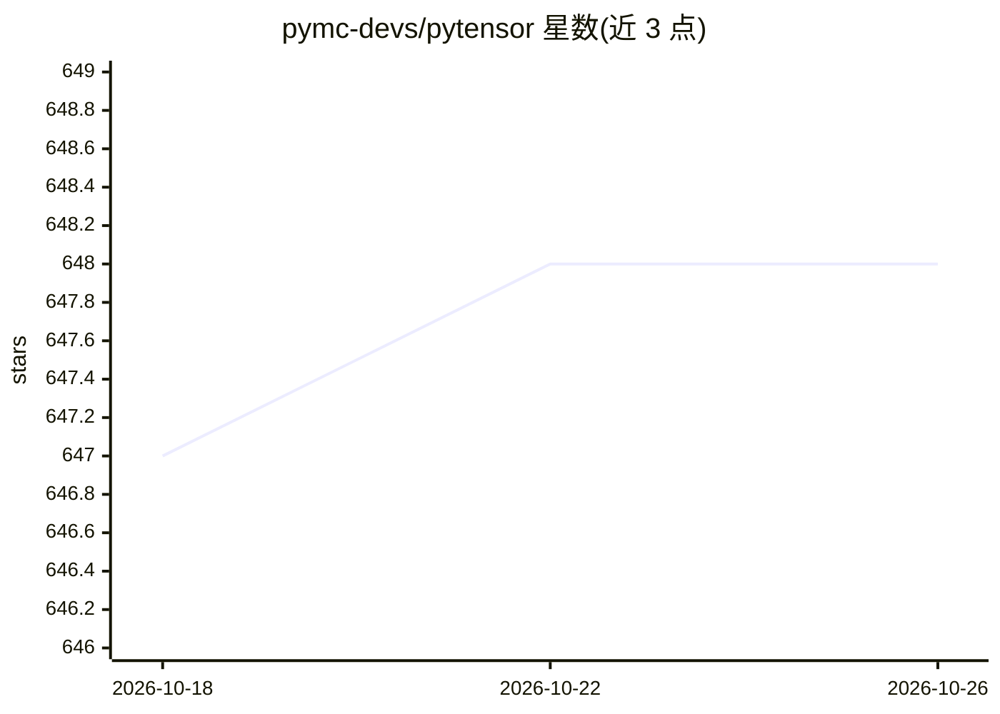

# pymc-devs/pytensor

⭐ 648 · Python · NOASSERTION · 推送 2026-10-23 · [GitHub](https://github.com/pymc-devs/pytensor) · [官网](https://pytensor.readthedocs.io) · 组织维护

**多维数组数学表达式的定义、优化与求值 Python 库**

Python 库，用于定义、优化并求值涉及多维数组的数学表达式：以符号变量构建计算图，通过 pytensor.function 编译为可调用对象，编译时移除冗余运算并将点积等替换为 BLAS 函数。维护静态计算图并支持原地修改以做优化，可经 C、JAX、Numba 编译。它是 PyMC 的计算后端，由 Aesara（Theano 的分支）fork 而来。提供 pip/conda-forge/GitHub 安装方式。

## 筛选速览

| 维度 | 判定 | 备注 |
|---|---|---|
| AI 角色 | `ai-ecosystem` | LLM/agent 周边工具 |
| 许可风险 | `none` | NOASSERTION |
| 部署形态 | `library` | 以包/库形式分发 |
| 模型依赖 | — | README 未给出锁定关系 |
| 硬件要求 | — | 无带数字的原话,不猜 |
| 安装摩擦 | `low` | 无编译、无系统依赖或容器化 |
| 成熟度 | — | 结构信号不足 |

## 能力要点

- 符号计算图定义与自动求梯度
- 编译时图优化：去除冗余运算、替换为 BLAS 函数
- 支持经 C、JAX、Numba 的图编译
- 作为 PyMC 的计算后端

## 适用场景

- 为贝叶斯建模框架提供底层张量计算与求值
- 构建并优化多维数组符号表达式
- 用不同后端（C/JAX/Numba）编译同一计算图

## 场景标签

 · 领域:科学计算/机器学习库

## 证据(README 行号)

> L8: |Project Name| is a Python library that allows one to define, optimize, and
> L10: It provides the computational backend for `PyMC <https://github.com/pymc-devs/pymc>`__.
> L16: - Implements an extensible graph transpilation framework that currently provides

## 星数曲线

2026-10-18 647 → 2026-10-26 648（+1）

---
*卡片 v1 · prompt 1.4 · 生成 2026-10-21 · 置信度 high · 依据 README sha `b3529414a347` · [字段定义](../../DATASET.md)*
