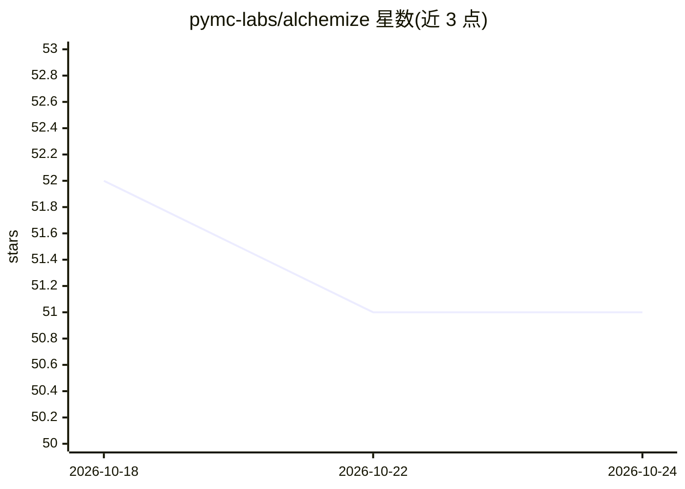

# pymc-labs/alchemize

⭐ 51 · Rust · Apache-2.0 · 推送 2026-10-23 · [GitHub](https://github.com/pymc-labs/alchemize) · 组织维护

**LLM 驱动的计算模型自纠错转译器：PyMC/Stan/JAX/PyTorch/Rust 互转**

由 PyMC Labs 维护的 AI agent 编译器：读取 PyMC/Stan/JAX/PyTorch 模型，提取参数、变换、logp 图与参考值，由 Claude agent 循环调用 write_rust_code、cargo_build、validate_logp 等工具生成目标实现，并用数值验证（logp 与梯度）驱动自动迭代修复。支持 GPU（CUDA）、Apple Accelerate（AMX）与 CPU 自动检测，内置 GP、ZeroSumNormal、Stan↔PyMC、JAX↔PyTorch、PyTorch→零依赖 Rust 二进制等技能。以 pip 包提供 CLI 与 Python API，需设置 ANTHROPIC_API_KEY。

## 筛选速览

| 维度 | 判定 | 备注 |
|---|---|---|
| AI 角色 | `ai-native` | 本体是模型或模型工具 |
| 许可风险 | `permissive` | Apache-2.0 |
| 部署形态 | `library` | 以包/库形式分发 |
| 模型依赖 | locked-api |  |
| 硬件要求 | — | 无带数字的原话,不猜 |
| 安装摩擦 | `medium` | 含编译或系统依赖之一 |
| 成熟度 | — | 结构信号不足 |

## 能力要点

- 提取→Claude agent 生成→数值验证→自动迭代修复的 agentic 编译循环
- PyMC/Stan/JAX/PyTorch 互转，并可编译为零依赖 Rust 二进制
- 硬件自动检测：CUDA → Apple Accelerate（AMX）→ CPU
- 已被用于将 posteriordb 全部 120 个 Stan 模型转译为 PyMC

## 适用场景

- 把 Stan 模型迁移到 PyMC 并做数值一致性校验
- 将 PyTorch 神经网络编译为无 ML 框架依赖的 Rust 部署产物
- 在 JAX 与 PyTorch 之间转换函数式/有状态代码

## 场景标签

`编码 Agent` · 领域:编码与开发

## 证据(README 行号)

> L3: An AI agent that acts as a compiler for computational models. It transpiles between probabilistic programming langua
> L16: 2. **Generate**: Claude (as an agent with tools) generates the target implementation
> L124: ├── compiler.py       # Agentic loop: Claude API → Rust code → build → validate

## 星数曲线

2026-10-18 52 → 2026-10-24 51（-1）

---
*卡片 v1 · prompt 1.4 · 生成 2026-10-24 · 置信度 high · 依据 README sha `c80c70248c37` · [字段定义](../../DATASET.md)*
