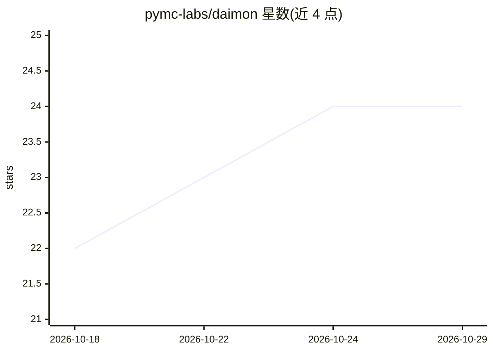

# pymc-labs/daimon

⭐ 24 · Python · MIT · 推送 2026-10-28 · [GitHub](https://github.com/pymc-labs/daimon) · [官网](https://daimon.pymc-labs.com/) · 组织维护

**面向团队聊天的开源数据科学 agent，运行分析并回帖**

由 PyMC Labs 开发的 Discord/Slack/Teams 聊天机器人：在频道中被 @ 后开线程，写代码、用 PyMC 拟合贝叶斯模型，回帖附模型、图表、不确定性解读与可复现的 marimo notebook。支持多轮上下文、定时例程任务、连接 Notion/Linear/GitHub 等 MCP 服务器，并提供 Claude Code 插件将实例暴露为 MCP 服务。基于 Anthropic Managed Agents 构建，可改用 OpenAI 后端（部分功能缺失）；自托管需 Docker、Postgres 与 API key，另有托管版。项目自述处于早期阶段。

## 筛选速览

| 维度 | 判定 | 备注 |
|---|---|---|
| AI 角色 | `ai-native` | 本体是模型或模型工具 |
| 许可风险 | `permissive` | MIT |
| 部署形态 | `self-host` | docker 或自建部署 |
| 模型依赖 | locked-api |  |
| 硬件要求 | — | 无带数字的原话,不猜 |
| 安装摩擦 | `low` | 无编译、无系统依赖或容器化 |
| 成熟度 | — | 结构信号不足 |

## 能力要点

- 线程内运行分析，返回模型、图表与可复现 marimo notebook
- 用 PyMC 拟合贝叶斯模型并给出不确定性解读
- 定时例程任务与 MCP 服务器（Notion/Linear/GitHub 等）接入
- 多租户隔离，一次部署服务多个 Discord 服务器/Slack 工作区

## 适用场景

- 在团队频道里直接提问做数据分析与 A/B 测试判断
- 定时拉取数据并在指定频道发布汇总
- 把分析实例作为 MCP 服务器接入 Claude Code

## 场景标签

`数据分析` `聊天机器人` · 领域:效率与自动化

## 证据(README 行号)

> L5: **The open source data science agent for Discord, Slack and Microsoft Teams.**
> L7: daimon joins your team's chat, writes and runs code, fits Bayesian models
> L8: with PyMC, and posts charts and runnable notebooks

## 星数曲线

2026-10-18 22 → 2026-10-29 24（+2）

---
*卡片 v1 · prompt 1.4 · 生成 2026-10-27 · 置信度 high · 依据 README sha `b0d92e294e85` · [字段定义](../../DATASET.md)*
