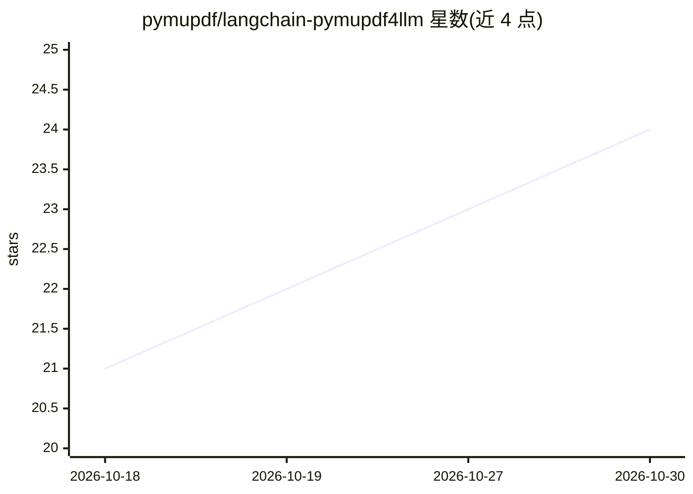

# pymupdf/langchain-pymupdf4llm

⭐ 24 · Python · AGPL-3.0 · 推送 2026-07-01 · [GitHub](https://github.com/pymupdf/langchain-pymupdf4llm) · 组织维护

**将 PyMuPDF4LLM PDF 转 Markdown 能力接入 LangChain 的文档加载器集成包**

由 PyMuPDF 团队维护的独立 LangChain 集成包，把 PyMuPDF4LLM 封装为 document loader 与 parser API：提取 PDF 中的文本、表格、标题、列表、代码块、多栏、图片与矢量图形为 Markdown，供 LLM 与 RAG 工作流使用。自 v1.28.0 起默认启用增强版面分析；提供可选的图片描述替换（搭配图像解析模型时以描述替代文件名引用）。依赖 Python 3.10+、LangChain Core v1.0+；因直接包装 AGPL/商业双模式的 PyMuPDF 栈，本包以 AGPL-3.0-only 分发。

## 筛选速览

| 维度 | 判定 | 备注 |
|---|---|---|
| AI 角色 | `ai-ecosystem` | LLM/agent 周边工具 |
| 许可风险 | `dual` | AGPL-3.0 |
| 部署形态 | `library` | 以包/库形式分发 |
| 模型依赖 | — | README 未给出锁定关系 |
| 硬件要求 | — | 无带数字的原话,不猜 |
| 安装摩擦 | `low` | 无编译、无系统依赖或容器化 |
| 成熟度 | — | 结构信号不足 |

## 能力要点

- PDF 内容提取为 Markdown，覆盖表格、多栏、图片、矢量图形
- 提供 LangChain loader 与 parser 双 API，支持 lazy_load 流式加载
- 可选图片描述替换（LLMImageBlobParser + 图像模型）
- 自 v1.28.0 默认启用 pymupdf4llm 增强版面分析

## 适用场景

- 在 LangChain RAG 流程中把 PDF 文档转为 Markdown 供检索
- 批量加载 PDF 并流式处理文档元数据
- 提取 PDF 图片并生成图片描述文本

## 场景标签

`文档解析` · 领域:知识与检索

## 证据(README 行号)

> L3: An independent LangChain integration package connecting PyMuPDF4LLM to LangChain
> L19: `langchain-pymupdf4llm` integrates PyMuPDF4LLM with LangChain as a document

## 星数曲线

2026-10-18 21 → 2026-10-30 24（+3）

---
*卡片 v1 · prompt 1.4 · 生成 2026-10-27 · 置信度 high · 依据 README sha `229224071c06` · [字段定义](../../DATASET.md)*
