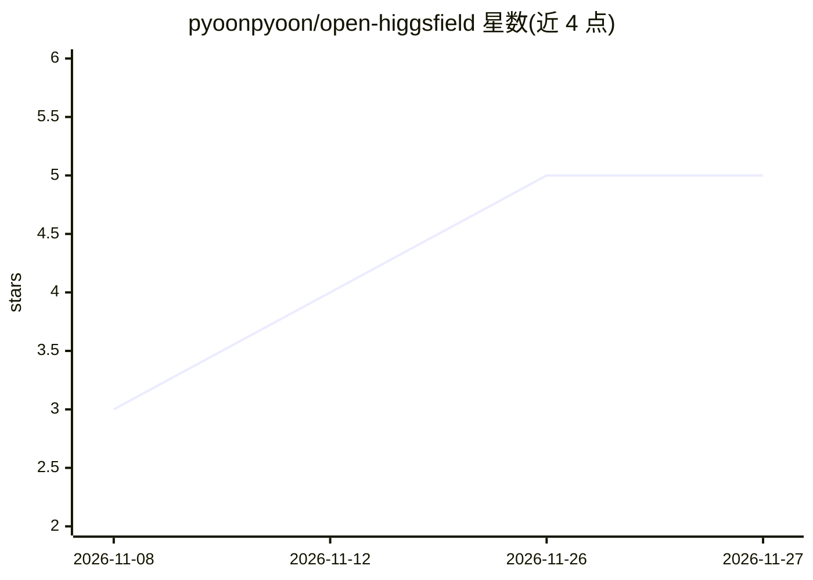

# pyoonpyoon/open-higgsfield

⭐ 5 · TypeScript · MIT · 推送 2026-10-19 · [GitHub](https://github.com/pyoonpyoon/open-higgsfield) · [官网](https://open-higgsfield-taupe-three.vercel.app) · 个人维护

**为照片重拍任意角度与电影运镜的 3D 虚拟片场**

基于 Comfy Developer Platform 与开源权重模型（Qwen-Image-Edit、LTX-2）重建 Higgsfield 的 Angles 与 Cinema Studio 两个功能：浏览器内用 three.js 搭 3D 机位并预览运镜，服务端编译为 ComfyUI workflow 执行，支持 96 个机位姿态与 15 种运镜（含 FOV 补偿 dolly zoom）。可用 Comfy Cloud 或本地 ComfyUI 作执行引擎；无 GPU 时以 dry-run 模式导出可自行运行的 workflow。需 Node 22+，模型权重体积较大（bf16 约 59 GB / GGUF 约 40 GB）。

## 筛选速览

| 维度 | 判定 | 备注 |
|---|---|---|
| AI 角色 | `ai-native` | 本体是模型或模型工具 |
| 许可风险 | `permissive` | MIT |
| 部署形态 | `library` | 以包/库形式分发 |
| 模型依赖 | — | README 未给出锁定关系 |
| 硬件要求 | — | 无带数字的原话,不猜 |
| 安装摩擦 | `medium` | 含编译或系统依赖之一 |
| 成熟度 | — | 结构信号不足 |

## 能力要点

- 拖拽 3D 机位球实现 8×4×3=96 个拍摄角度的重拍
- 15 种电影运镜，7 种由官方 LTX camera-control LoRA 驱动
- 无 GPU 的 dry-run 模式：编译并导出完整 ComfyUI workflow
- 本地部署完全开放权重，workflows/manifest.json 列出全部模型及许可

## 适用场景

- 把单张照片重拍成任意角度的新图
- 为静态照片生成电影感的运镜视频
- 在 ComfyUI 中复现/检查每条镜头的具体 workflow

## 场景标签

`图像生成` `视频生成` · 领域:内容生成

## 证据(README 行号)

> L3: **A virtual film set for any photo.** Drop in a subject, drag a camera anywhere around it in 3D, preview the move on
> L37: * **Angle stage:** Qwen-Image-Edit-2511 + the Multiple-Angles LoRA (8 azimuths × 4 elevations × 3 distances = 96 po
> L69: ### Engine B: your own ComfyUI (fully local, open weights)

## 星数曲线

2026-11-08 3 → 2026-11-27 5（+2）

---
*卡片 v1 · prompt 1.4 · 生成 2026-11-26 · 置信度 mid · 依据 README sha `1f8ea2155b5d` · [字段定义](../../DATASET.md)*
