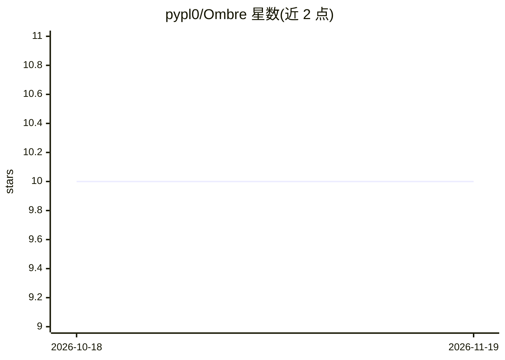

# pypl0/Ombre

⭐ 10 · Python · 推送 2026-05-01 · [GitHub](https://github.com/pypl0/Ombre) · 个人维护

**AI 应用安全中间件：一行代码接入请求侧防护与审计**

以 Python 中间件形式提供的 AI 基础设施层，宣称在每次模型请求路径上运行多个代理（agent），覆盖安全扫描、缓存、内存、幻觉检测、防篡改审计链（SHA-256）、PII 令牌化、行为约束、合规（EU AI Act/HIPAA）与成本跟踪等功能，由 Sentinel 协调并共享威胁情报总线，支持接入 OpenAI/Anthropic/Groq/Mistral 等模型。README 以对标 Project Glasswing 叙事介绍动机，标注数据不出服务器。安装通过 pip 从 GitHub 源码进行。

## 筛选速览

| 维度 | 判定 | 备注 |
|---|---|---|
| AI 角色 | `ai-ecosystem` | LLM/agent 周边工具 |
| 许可风险 | `none` | — |
| 部署形态 | `library` | 以包/库形式分发 |
| 模型依赖 | — | README 未给出锁定关系 |
| 硬件要求 | — | 无带数字的原话,不猜 |
| 安装摩擦 | `low` | 无编译、无系统依赖或容器化 |
| 成熟度 | — | 结构信号不足 |

## 能力要点

- 请求路径上的多代理编排：Sentinel 协调安全、缓存、记忆、幻觉检测等模块
- SHA-256 防篡改审计链与 PII 令牌化
- 声明对接 OpenAI / Anthropic / Groq / Mistral 等模型后端
- 一行代码接入，数据留在自有服务器

## 适用场景

- 为调用 LLM 的应用在请求层加安全防护与审计
- 对 AI 出入参做 PII 脱敏与合规记录
- 为多模型后端统一加缓存与成本跟踪

## 场景标签

`网络安全` `LLM 可观测性` · 领域:评测与运维

## 证据(README 行号)

> L43: ## The Security Perimeter
> L66: Any AI Model (OpenAI / Anthropic / Groq / Mistral)
> L71: pip install git+https://github.com/pypl0/Ombre.git

## 星数曲线

2026-10-18 10 → 2026-11-19 10（+0）

---
*卡片 v1 · prompt 1.4 · 生成 2026-11-19 · 置信度 mid · 依据 README sha `6cad854eaeb6` · [字段定义](../../DATASET.md)*
