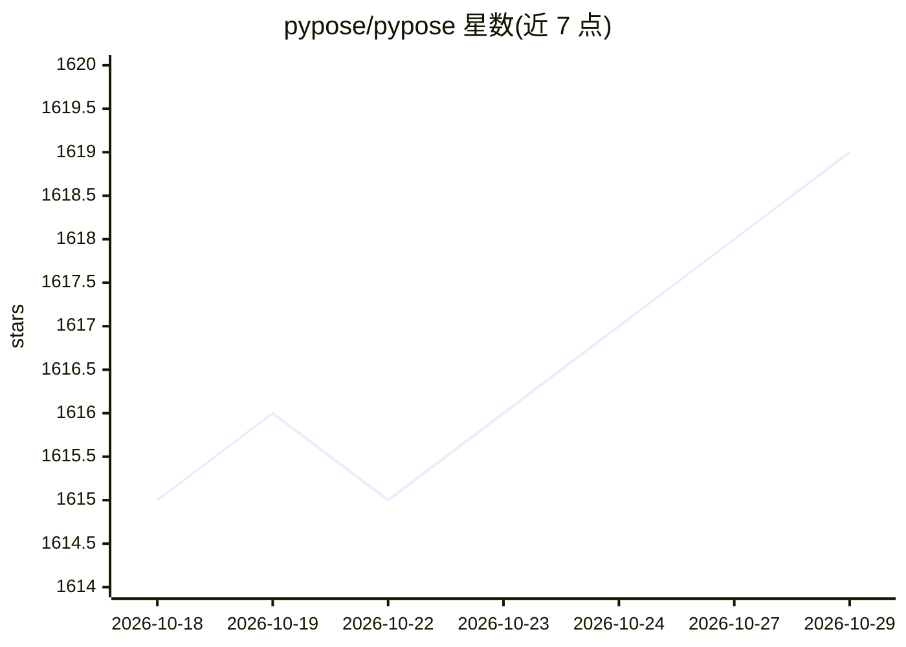

# pypose/pypose

⭐ 1,619 · Python · Apache-2.0 · 推送 2026-10-25 · [GitHub](https://github.com/pypose/pypose) · [官网](https://pypose.org) · 组织维护

**面向机器人学的 PyTorch 李群可微优化库**

基于 PyTorch 的机器人学库，将深度感知模型与基于物理的优化结合，在李群/李代数（SO3、SE3、Sim3、RxSO3）上提供可微张量 LieTensor 运算。模块覆盖系统模型（LTI/LTV/NLS）、滤波器（EKF/UKF/PF）、EPnP、LQR、IMU 预积分，以及 GaussNewton、LevenbergMarquardt 等二阶优化器，支持批量李群雅可比的并行计算与稀疏雅可比追踪（v0.9.5）。以命令式接口提供，面向机器人算法研究与应用开发者，从 PyPI 或源码安装，依赖 PyTorch。

## 筛选速览

| 维度 | 判定 | 备注 |
|---|---|---|
| AI 角色 | `ai-native` | 本体是模型或模型工具 |
| 许可风险 | `permissive` | Apache-2.0 |
| 部署形态 | `library` | 以包/库形式分发 |
| 模型依赖 | — | README 未给出锁定关系 |
| 硬件要求 | — | 无带数字的原话,不猜 |
| 安装摩擦 | `low` | 无编译、无系统依赖或容器化 |
| 成熟度 | — | 结构信号不足 |

## 能力要点

- 李群/李代数 LieTensor 可微运算（SO3/SE3/Sim3/RxSO3）
- EKF/UKF/PF 滤波、LQR、EPnP、IMU 预积分模块
- GaussNewton、LevenbergMarquardt 二阶优化器
- 批量李群雅可比并行计算与稀疏二阶优化（加速 BA 等应用）

## 适用场景

- 机器人状态估计与滤波（EKF/UKF/IMU 预积分）
- 位姿图优化与 Bundle Adjustment
- 在李群上做可微计算并接入 PyTorch 深度学习模型

## 场景标签

 · 领域:机器人/几何计算库

## 证据(README 行号)

> L5: Deep learning has had remarkable success in robotic perception, but its data-centric nature suffers when it comes to
> L1: ## PyPose: A Library for Robot Learning with Physics-based Optimization

## 星数曲线

2026-10-18 1,615 → 2026-10-29 1,619（+4）

---
*卡片 v1 · prompt 1.4 · 生成 2026-10-21 · 置信度 high · 依据 README sha `a7980cb39d34` · [字段定义](../../DATASET.md)*
