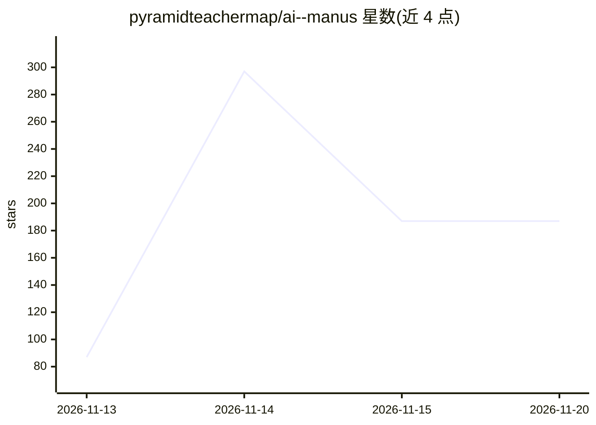

# pyramidteachermap/ai--manus

⭐ 187 · Apache-2.0 · 推送 2026-11-15 · [GitHub](https://github.com/pyramidteachermap/ai--manus) · 个人维护

**面向个人用户的自主 AI Agent：自动执行代码与浏览器操作**

README 描述了一个名为 Manus 的自主 AI 代理，定位为代替用户执行代码与控制浏览器的通用助手：可编写并运行脚本、打开网页、填写表单、执行多步骤任务，并声称跨会话保持行为一致。目标用户为学生、远程工作者与处理小型项目的个人，覆盖学习研究、家庭项目、轻办公与开发测试场景。README 给出 CPU/内存等兼容性表与六步上手流程，但未提供任何安装命令、代码入口或技术实现细节，仅含'Download Manus'字样与促销码 PROMO2026，内容以功能宣传为主。

## 筛选速览

| 维度 | 判定 | 备注 |
|---|---|---|
| AI 角色 | `ai-native` | 本体是模型或模型工具 |
| 许可风险 | `permissive` | Apache-2.0 |
| 部署形态 | `None` |  |
| 模型依赖 | — | README 未给出锁定关系 |
| 硬件要求 | — | 无带数字的原话,不猜 |
| 安装摩擦 | `low` | 无编译、无系统依赖或容器化 |
| 成熟度 | — | 结构信号不足 |

## 能力要点

- 自主执行代码与脚本（Autonomous Code Execution）
- 浏览器控制：导航网页、填表、收集信息
- 代码与浏览器操作可在同一工作流中衔接
- 面向家庭、学习与轻量任务的小规模定位

## 适用场景

- 让代理代为收集资料、跑小脚本、整理笔记
- 自动填写重复表单与多页面信息采集
- 在少量监督下执行多步骤日常任务

## 场景标签

`浏览器自动化` `编码 Agent` · 领域:效率与自动化

## 证据(README 行号)

> L10: - **Autonomous Code Execution:** Manus AI agent runs code on its own to complete tasks, so you can focus on decisio
> L18: Manus is an autonomous AI agent designed to run code and control a browser on your behalf. Instead of acting like a

## 星数曲线

2026-11-13 87 → 2026-11-20 187（+100）

---
*卡片 v1 · prompt 1.4 · 生成 2026-11-17 · 置信度 low · 依据 README sha `fbfd5e977bf4` · [字段定义](../../DATASET.md)*
