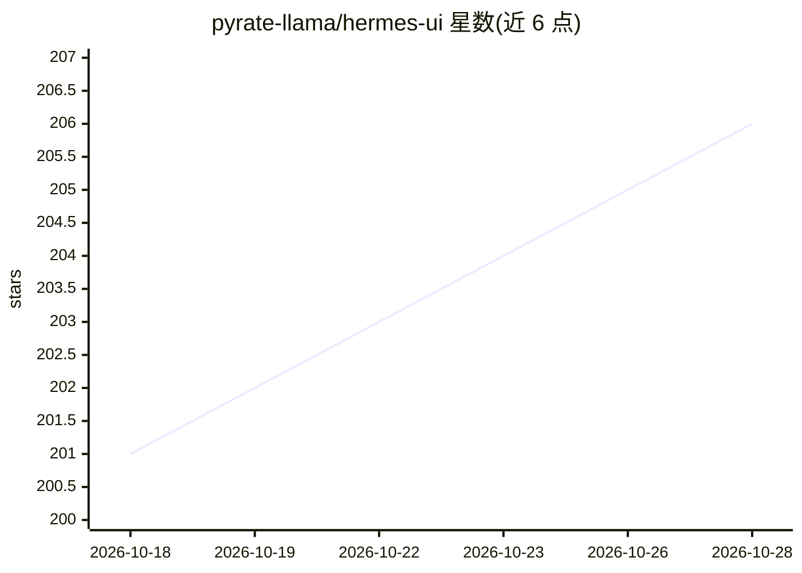

# pyrate-llama/hermes-ui

⭐ 206 · HTML · MIT · 推送 2026-06-30 · [GitHub](https://github.com/pyrate-llama/hermes-ui) · 个人维护 · 中文 README

**Hermes Agent 的 Web 控制台：聊天、监控与技能管理的单文件界面**

基于 React 18 的单文件 HTML 应用，配合轻量 Python 代理服务器，为 Hermes Agent 提供操作界面：聊天（含内联图像生成、流式响应与实时日志面板）、任务板跟踪工具调用、仪表盘统计、技能浏览管理、定时任务、MCP 服务器分组展示、工作区文件浏览与内置终端（含 Hermes 和 Claude Code 标签页）。近期版本主要修复会话上下文修复、工具回执恢复与大对话内存占用问题。面向自托管 Hermes Agent 的用户。

## 筛选速览

| 维度 | 判定 | 备注 |
|---|---|---|
| AI 角色 | `ai-ecosystem` | LLM/agent 周边工具 |
| 许可风险 | `permissive` | MIT |
| 部署形态 | `library` | 以包/库形式分发 |
| 模型依赖 | — | README 未给出锁定关系 |
| 硬件要求 | — | 无带数字的原话,不猜 |
| 安装摩擦 | `low` | 无编译、无系统依赖或容器化 |
| 成熟度 | — | 结构信号不足 |

## 能力要点

- 单文件 HTML（React 18）+ Python 代理服务器的架构
- 覆盖聊天、任务板、技能管理、定时任务、MCP 工具、文件浏览与终端的完整界面
- 浏览器/服务器会话转录修复与工具回执恢复机制
- 支持视频上传到工作区并以本地路径附加到提示词

## 适用场景

- 给自托管的 Hermes Agent 提供图形化操作与监控界面
- 在浏览器中管理技能、定时任务与 MCP 服务器
- 实时查看 agent 工具调用与后台任务进展

## 场景标签

 · 领域:LLM/Agent 工具界面

## 证据(README 行号)

> L5: The command center for Hermes Agent — chat, steer, browse files, manage skills, and monitor everything from a single
> L7: Built as a single-file HTML application with React 18, Hermes UI provides a full-featured chat interface, real-time 

## 星数曲线

2026-10-18 201 → 2026-10-28 206（+5）

---
*卡片 v1 · prompt 1.4 · 生成 2026-10-22 · 置信度 low · 依据 README sha `25af77ad7675` · [字段定义](../../DATASET.md)*
