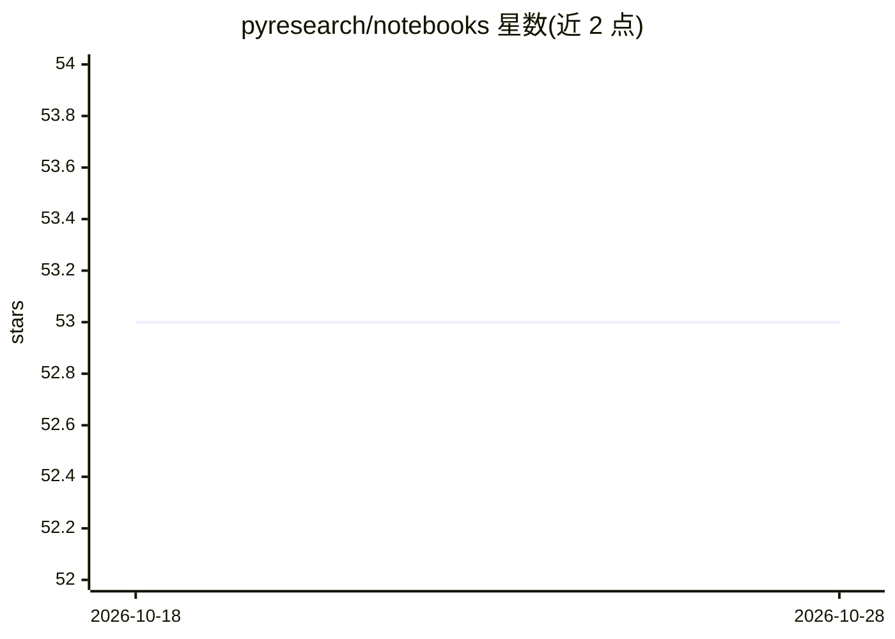

# pyresearch/notebooks

⭐ 53 · Jupyter Notebook · MIT · 推送 2026-01-15 · [GitHub](https://github.com/pyresearch/notebooks) · [官网](https://pyresearch.org/) · 组织维护

**计算机视觉模型训练教程与 Colab 笔记本合集**

PyResearch 维护的计算机视觉教程仓库：以表格形式列出 14 个 Jupyter 笔记本，覆盖 YOLO 系列（YOLO26/YOLOv12/YOLOv9/YOLOv10/YOLO11）、RF-DETR、RT-DETR、Detectron2、Grounded SAM 2、DINOv2 等模型的自定义数据集训练、姿态估计、实例分割与自动标注，每个条目附 Open in Colab 链接与 YouTube 视频教程。README 提供 pip install pyresearch 安装命令，面向跟随教程学习目标检测与图像分割的学习者。

## 筛选速览

| 维度 | 判定 | 备注 |
|---|---|---|
| AI 角色 | `ai-knowledge` | 知识聚合/清单类 |
| 许可风险 | `permissive` | MIT |
| 部署形态 | `library` | 以包/库形式分发 |
| 模型依赖 | — | README 未给出锁定关系 |
| 硬件要求 | — | 无带数字的原话,不猜 |
| 安装摩擦 | `low` | 无编译、无系统依赖或容器化 |
| 成熟度 | — | 结构信号不足 |

## 能力要点

- 14 个 Colab 可运行的计算机视觉笔记本
- 覆盖 YOLO 多版本、DETR 系、Detectron2、DINOv2 等模型
- 每个教程配 YouTube 视频讲解
- 提供 pip install pyresearch 安装

## 适用场景

- 在 Colab 上跟随教程训练自定义数据集的目标检测模型
- 学习 YOLO/DETR 等模型的微调与实例分割流程
- 用 Grounded SAM 2 笔记本自动标注图像

## 场景标签

`教程课程` `目标检测` `微调` · 领域:学习与行业

## 证据(README 行号)

> L21:  State-of-the-Art Computer Vision Notebooks & Tutorials
> L61:  🚀 Model Tutorials (Notebooks)

## 星数曲线

2026-10-18 53 → 2026-10-28 53（+0）

---
*卡片 v1 · prompt 1.4 · 生成 2026-10-24 · 置信度 high · 依据 README sha `0d57e8444a86` · [字段定义](../../DATASET.md)*
