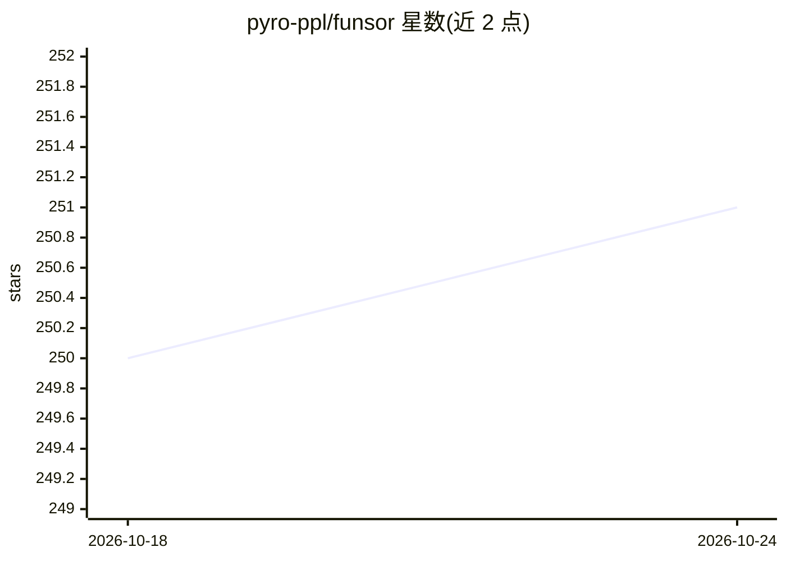

# pyro-ppl/funsor

⭐ 251 · Python · Apache-2.0 · 推送 2026-08-03 · [GitHub](https://github.com/pyro-ppl/funsor) · [官网](https://funsor.pyro.ai) · 组织维护

**面向概率编程的函数式张量库，支撑 Pyro 延迟推断**

Funsor 是一个把张量接口推广到任意多元函数与概率分布的库（functional tensors），供概率编程使用。三种设计：把开放项作为对象、支持 eager/lazy/混合/近似等非标准解释、全部维度命名并以代换为基本操作。可通过 PyTorch 优化器直接做概率计算，或实现 Pyro 内自定义推断算法；附 funsor.pyro（Pyro 兼容分布类）与 funsor.minipyro（可精确计算部分 ELBO 的备用后端）。目标是把 Pyro 的延迟推断从离散推广到连续变量。

## 筛选速览

| 维度 | 判定 | 备注 |
|---|---|---|
| AI 角色 | `ai-ecosystem` | LLM/agent 周边工具 |
| 许可风险 | `permissive` | Apache-2.0 |
| 部署形态 | `library` | 以包/库形式分发 |
| 模型依赖 | — | README 未给出锁定关系 |
| 硬件要求 | — | 无带数字的原话,不猜 |
| 安装摩擦 | `low` | 无编译、无系统依赖或容器化 |
| 成熟度 | — | 结构信号不足 |

## 能力要点

- 将张量接口推广为多元函数与分布的第一类对象
- 支持 eager/lazy/混合/记忆化与 Monte Carlo 等自定义解释
- 所有维度命名，代换（substitution）为基本操作
- funsor.pyro 提供 Pyro/PyTorch 兼容分布类，funsor.minipyro 可精确计算部分 ELBO

## 适用场景

- 在 Pyro 中实现自定义 ELBO 与推断算法
- 实现离散/连续混合模型的延迟采样
- 用 PyTorch 优化器直接做概率计算（HMM、卡尔曼滤波、VAE 等）

## 场景标签

 · 领域:机器学习/概率编程

## 证据(README 行号)

> L7: Funsor is a tensor-like library for functions and distributions.
> L63: The goal of this library is to generalize Pyro's delayed

## 星数曲线

2026-10-18 250 → 2026-10-24 251（+1）

---
*卡片 v1 · prompt 1.4 · 生成 2026-10-22 · 置信度 high · 依据 README sha `495309ff088e` · [字段定义](../../DATASET.md)*
