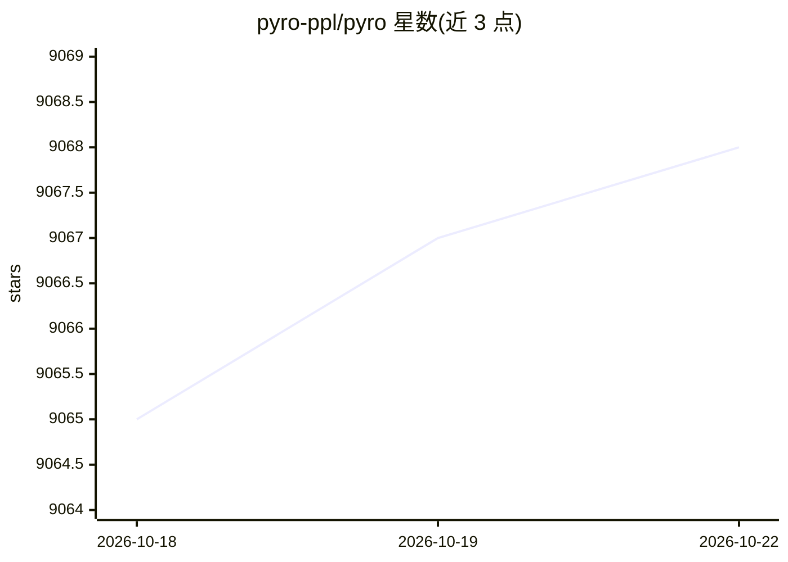

# pyro-ppl/pyro

⭐ 9,068 · Python · Apache-2.0 · 推送 2026-10-05 · [GitHub](https://github.com/pyro-ppl/pyro) · [官网](http://pyro.ai) · 组织维护

**基于 PyTorch 的通用深度概率编程库，供研究者做贝叶斯建模与变分推断**

Pyro 是构建在 PyTorch 之上的深度概率编程库（PPL），可表示任意可计算概率分布，支持在大规模数据上以较小开销进行推断，核心由少量可组合抽象实现，兼顾自动化推断与专家自定义。提供生成模型与推断模型的高层表达，通过 pip 或源码安装，可加装 extras 运行示例与教程中的概率模型，也可从 Docker 容器运行。最初在 Uber AI 开发，现为 Linux Foundation 项目，由社区贡献者及 Broad Institute 团队维护。

## 筛选速览

| 维度 | 判定 | 备注 |
|---|---|---|
| AI 角色 | `ai-native` | 本体是模型或模型工具 |
| 许可风险 | `permissive` | Apache-2.0 |
| 部署形态 | `library` | 以包/库形式分发 |
| 模型依赖 | — | README 未给出锁定关系 |
| 硬件要求 | — | 无带数字的原话,不猜 |
| 安装摩擦 | `low` | 无编译、无系统依赖或容器化 |
| 成熟度 | — | 结构信号不足 |

## 能力要点

- 通用 PPL：可表示任意可计算概率分布
- 基于 PyTorch 构建，支持大规模数据推断
- 少量可组合抽象构成的核心，支持自定义推断
- 支持 pip / 源码 / extras / Docker 方式安装运行

## 适用场景

- 构建贝叶斯深度学习模型并做变分推断
- 用 PPL 表达生成模型与推断模型进行科研实验
- 运行官方 examples/tutorials 中的概率模型学习建模方法

## 场景标签

 · 领域:机器学习/概率编程

## 证据(README 行号)

> L12: Pyro is a flexible, scalable deep probabilistic programming library built on PyTorch. Notably, it was designed with
> L14: - **Universal**: Pyro is a universal PPL - it can represent any computable probability distribution.

## 星数曲线

2026-10-18 9,065 → 2026-10-22 9,068（+3）

---
*卡片 v1 · prompt 1.4 · 生成 2026-10-20 · 置信度 high · 依据 README sha `49b459d579fb` · [字段定义](../../DATASET.md)*
