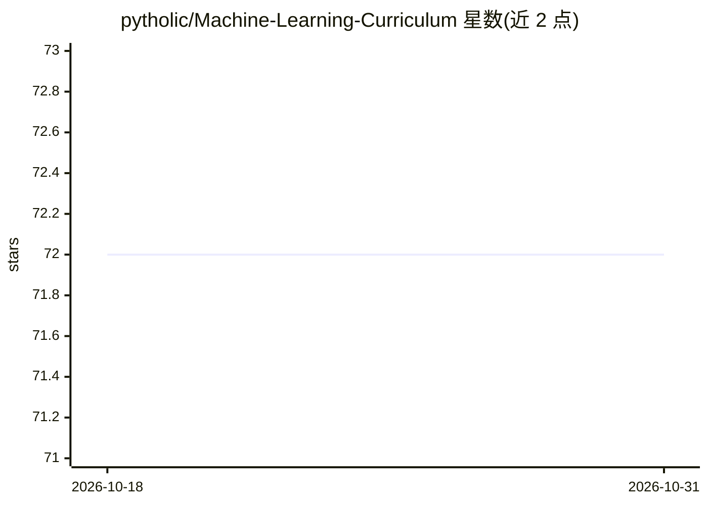

# pytholic/Machine-Learning-Curriculum

⭐ 72 · 推送 2026-01-13 · [GitHub](https://github.com/pytholic/Machine-Learning-Curriculum) · 个人维护

**机器学习 A 到 Z 学习路线清单：课程、书籍与资源策展**

个人维护的机器学习入门到进阶课程清单：主课程按基础、机器学习、深度学习分节排序，配套参考书籍、附加课程、YouTube 频道、博客、newsletter、教程与分级博文（初/中/高）等资源条目，条目格式为名称+链接+机构。面向新手与转行从业者，也供 ML 工程师复习概念；接受社区 PR 补充资源但不修改主清单，MLOps 与实践项目计划另建仓库，论文部分暂未填充。

## 筛选速览

| 维度 | 判定 | 备注 |
|---|---|---|
| AI 角色 | `ai-knowledge` | 知识聚合/清单类 |
| 许可风险 | `none` | — |
| 部署形态 | `None` |  |
| 模型依赖 | — | README 未给出锁定关系 |
| 硬件要求 | — | 无带数字的原话,不猜 |
| 安装摩擦 | `low` | 无编译、无系统依赖或容器化 |
| 成熟度 | — | 结构信号不足 |

## 能力要点

- 主课程按 Foundations/ML/DL 三节顺序组织
- 附加资源覆盖课程、书籍、YouTube、博客、newsletter、教程
- Gold Blog Posts 按初/中/高三级整理经典博文
- 接受 PR 贡献但主清单不改动

## 适用场景

- 零基础按顺序跟学机器学习入门课程
- 转行从业者寻找结构化 ML/DL 学习路线
- 查找经典论文解读博文与参考书目

## 场景标签

`精选清单` · 领域:学习与行业

## 证据(README 行号)

> L35: # Main Curriculum 📌
> L66: # Additional Resources 🗞️

## 星数曲线

2026-10-18 72 → 2026-10-31 72（+0）

---
*卡片 v1 · prompt 1.4 · 生成 2026-10-24 · 置信度 high · 依据 README sha `10b95bce1e50` · [字段定义](../../DATASET.md)*
