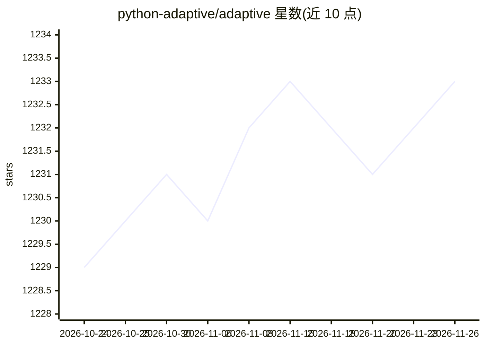

# python-adaptive/adaptive

⭐ 1,233 · Python · BSD-3-Clause · 推送 2026-11-23 · [GitHub](https://github.com/python-adaptive/adaptive) · [官网](http://adaptive.readthedocs.io/) · 组织维护

**数学函数的自适应并行采样 Python 库**

面向科研与计算场景的开源 Python 库：用户提供函数与参数边界，库按 loss 函数在参数空间选择"最有信息量"的采样点，替代稠密网格全量求值。内置 1D/2D/ND、积分、随机变量平均、随机过程等多种 learner 与元 learner，支持自定义 loss；默认用 loky 在本机多核并行，内置 concurrent.futures、mpi4py、loky、ipyparallel、distributed 执行器，可在集群运行。限制：单次求值约需 ≥50ms 才划算，高维下 LearnerND 变慢。

## 筛选速览

| 维度 | 判定 | 备注 |
|---|---|---|
| AI 角色 | `ai-native` | 本体是模型或模型工具 |
| 许可风险 | `permissive` | BSD-3-Clause |
| 部署形态 | `library` | 以包/库形式分发 |
| 模型依赖 | — | README 未给出锁定关系 |
| 硬件要求 | — | 无带数字的原话,不猜 |
| 安装摩擦 | `medium` | 含编译或系统依赖之一 |
| 成熟度 | — | 结构信号不足 |

## 能力要点

- 7 种 learner 与 BalancingLearner/DataSaver 元 learner，支持自定义 loss 函数
- 内置 5 种并行执行器（含 mpi4py、ipyparallel、distributed），可跨机器采样
- Jupyter 中 Runner 后台运行并实时绘图，数据可导出 pandas DataFrame
- 可选 adaptive-triangulation 包用 Rust 后端加速 LearnerND 三角剖分

## 适用场景

- 对昂贵的数值计算做自适应采样，减少网格求值点数
- 在计算集群上并行采样函数并实时监控收敛过程
- 对随机变量或随机过程做自适应平均估计
- 1D 函数的自适应积分求值

## 场景标签

`科研工具` · 领域:学习与行业

## 证据(README 行号)

> L13: `adaptive` is an open-source Python library for adaptive parallel function evaluation.
> L53: A learner samples a function at the points in its parameter space that tell it the most about the function.
> L75: In addition to the learners, `adaptive` provides primitives for running the sampling across several cores and even 

## 星数曲线

2026-10-24 1,229 → 2026-11-26 1,233（+4）

---
*卡片 v1 · prompt 1.4 · 生成 2026-11-24 · 置信度 high · 依据 README sha `e1a63039642f` · [字段定义](../../DATASET.md)*
