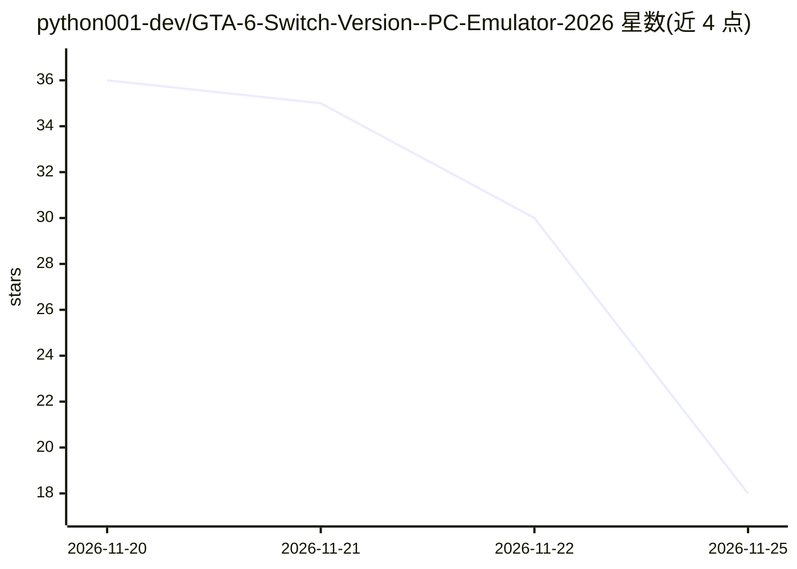

# python001-dev/GTA-6-Switch-Version--PC-Emulator-2026

⭐ — · [GitHub]() · 个人维护

**面向 Windows 玩家的 GTA VI PC 版安装与配置指南站**

一个针对 Grand Theft Auto VI 未来 PC 版的 Windows 安装与配置资源：覆盖系统准备（Windows 更新、GPU 驱动、存储检查）、Rockstar Games Launcher 准备、图形设置说明、FPS 与卡顿排查，以及安装错误处理。仓库自带的 Windows 安装包是设置伴侣工具，明确声明不含也不安装游戏文件；截至文内日期 PC 版发布日期与官方硬件要求均未公布，多数规格标注为 Not confirmed，末节列出 SEO 关键词。

## 筛选速览

| 维度 | 判定 | 备注 |
|---|---|---|
| AI 角色 | `ai-knowledge` | 知识聚合/清单类 |
| 许可风险 | `permissive` | — |
| 部署形态 | `desktop` | 安装包/桌面程序 |
| 模型依赖 | — | README 未给出锁定关系 |
| 硬件要求 | — | 无带数字的原话,不猜 |
| 安装摩擦 | `low` | 无编译、无系统依赖或容器化 |
| 成熟度 | `idea` | |

## 能力要点

- Windows 兼容性准备：DirectX 检查、驱动验证、存储与硬件信息
- 图形设置与 FPS 优化/卡顿排查条目
- 安装伴侣工具明确声明不含 GTA VI 游戏文件
- 官方系统要求表全部标注 Not confirmed

## 适用场景

- 为未来 GTA VI PC 版提前准备 Windows 环境与驱动
- 排查 PC 游戏常见的低 FPS、卡顿与显示问题
- 查阅 Rockstar 官方资源链接

## 场景标签

 · 领域:游戏/桌面工具

## 证据(README 行号)

> L5: A dedicated PC installation and configuration resource for Grand Theft Auto VI, covering Windows preparation, graphi
> L17: This repository is dedicated to Windows users preparing for the future PC edition of GTA VI.
> L49: The companion installer does not contain or install GTA VI game files.

## 星数曲线

2026-11-20 36 → 2026-11-25 18（-18）

---
*卡片 v1 · prompt 1.4 · 生成 2026-11-22 · 置信度 low · 依据 README sha `2fe487426686` · [字段定义](../../DATASET.md)*
