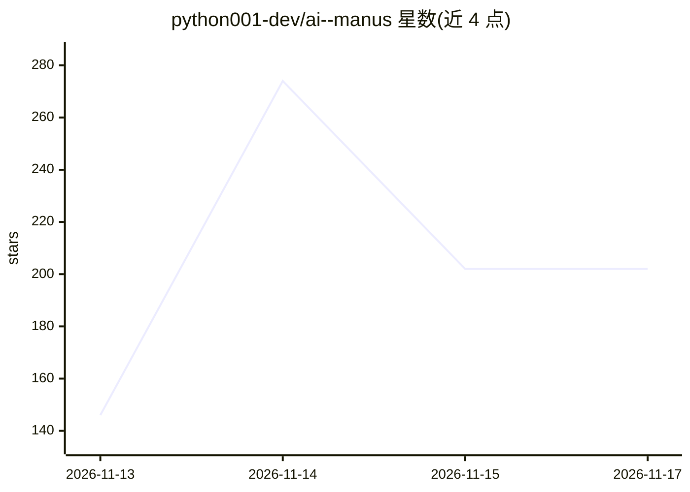

# python001-dev/ai--manus

⭐ 202 · Apache-2.0 · 推送 2026-11-15 · [GitHub](https://github.com/python001-dev/ai--manus) · 个人维护

**自主 AI Agent：代用户执行代码与控制浏览器完成任务**

面向日常与轻量任务用户的自主 AI Agent 应用：用户以自然语言描述需求，Agent 自行编写并执行脚本、打开网页、填写表单、跨多步完成任务，可在脚本与浏览器操作间衔接。README 定位为家庭、学习与小规模办公场景的助手，非企业平台。内容以营销式功能描述为主，未给出具体技术实现、模型接入方式或安装命令，仅提供兼容性表（最低双核 CPU、4 GB 内存）与使用步骤。

## 筛选速览

| 维度 | 判定 | 备注 |
|---|---|---|
| AI 角色 | `ai-native` | 本体是模型或模型工具 |
| 许可风险 | `permissive` | Apache-2.0 |
| 部署形态 | `None` |  |
| 模型依赖 | — | README 未给出锁定关系 |
| 硬件要求 | — | 无带数字的原话,不猜 |
| 安装摩擦 | `low` | 无编译、无系统依赖或容器化 |
| 成熟度 | — | 结构信号不足 |

## 能力要点

- 自主编写并执行代码完成任务
- 浏览器控制：导航网页、填写表单、采集信息
- 脚本与浏览器操作在同一任务流中衔接
- 会话间记忆并复用工作流模式

## 适用场景

- 让 Agent 代为查网页、填表单、收集资料
- 自动运行小脚本、整理研究笔记
- 远程支持中自动执行诊断步骤

## 场景标签

`浏览器自动化` `AI 助手` · 领域:效率与自动化

## 证据(README 行号)

> L10: - **Autonomous Code Execution:** Manus AI agent runs code on its own to complete tasks, so you can focus on decisio
> L18: Manus is an autonomous AI agent designed to run code and control a browser on your behalf. Instead of acting like a

## 星数曲线

2026-11-13 146 → 2026-11-17 202（+56）

---
*卡片 v1 · prompt 1.4 · 生成 2026-11-17 · 置信度 mid · 依据 README sha `fbfd5e977bf4` · [字段定义](../../DATASET.md)*
