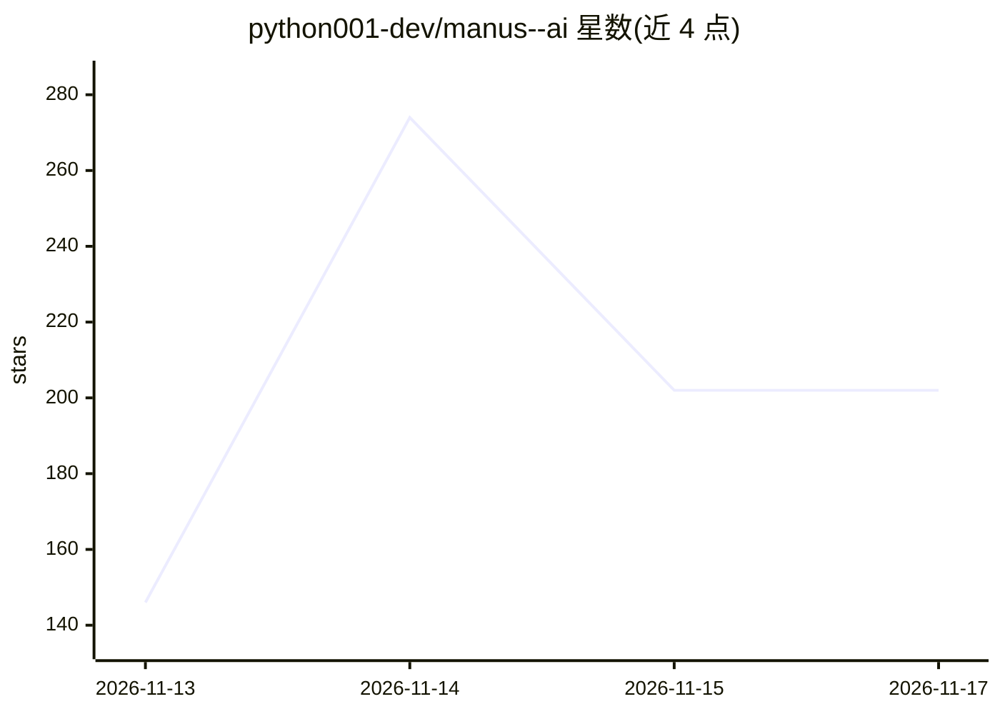

# python001-dev/manus--ai

⭐ 202 · Apache-2.0 · 推送 2026-11-15 · [GitHub](https://github.com/python001-dev/manus--ai) · 个人维护 · 中文 README

**面向日常任务的自主 AI Agent：自主执行代码并控制浏览器**

Manus 是一个自主 AI agent，代替用户执行代码与控制浏览器：编写并运行脚本、打开网页、填写表单、完成多步骤任务，需少量监督即可运行。定位为家庭、学习与轻量办公场景的个人助手，面向非开发者的普通用户，而非企业平台。README 给出兼容性表（最低 4GB 内存、双核 CPU）与上手流程（准备/配置/测试/调整），但未提供具体的安装命令或代码入口，描述以功能介绍与场景列举为主。

## 筛选速览

| 维度 | 判定 | 备注 |
|---|---|---|
| AI 角色 | `ai-native` | 本体是模型或模型工具 |
| 许可风险 | `permissive` | Apache-2.0 |
| 部署形态 | `None` |  |
| 模型依赖 | — | README 未给出锁定关系 |
| 硬件要求 | — | 无带数字的原话,不猜 |
| 安装摩擦 | `low` | 无编译、无系统依赖或容器化 |
| 成熟度 | — | 结构信号不足 |

## 能力要点

- 自主执行代码完成多步骤任务
- 浏览器控制：导航网页、填写表单、收集信息
- 代码与浏览器动作在同一任务流中衔接
- 后台常驻的个人助手形态

## 适用场景

- 让 agent 代为收集网页资料并整理摘要
- 自动执行重复性脚本与文件整理
- 学习与轻度办公中委派小任务

## 场景标签

`AI 助手` `浏览器自动化` · 领域:效率与自动化

## 证据(README 行号)

> L10: - **Autonomous Code Execution:** Manus AI agent runs code on its own to complete tasks, so you can focus on decisio
> L18: Manus is an autonomous AI agent designed to run code and control a browser on your behalf. Instead of acting like a

## 星数曲线

2026-11-13 146 → 2026-11-17 202（+56）

---
*卡片 v1 · prompt 1.4 · 生成 2026-11-17 · 置信度 mid · 依据 README sha `0f78ee3a5dd2` · [字段定义](../../DATASET.md)*
