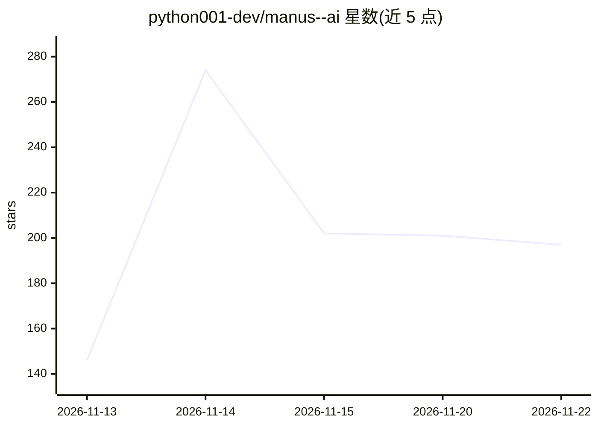

# python001-dev/manus--ai

⭐ 197 · Apache-2.0 · 推送 2026-11-21 · [GitHub](https://github.com/python001-dev/manus--ai) · 个人维护

**面向个人用户的自主 AI Agent：代跑代码与操控浏览器**

README 以功能介绍为主：Manus 定位为自主 AI agent，可自主编写并执行脚本、控制浏览器（导航网页、填表、采集信息）、执行多步骤任务，并可作为后台个人助理处理学习、家庭与轻量办公场景中的重复性工作。代码执行与浏览器控制可在同一流程内衔接。README 提供了兼容性硬件表（最低 4GB 内存、双核 CPU）与上手步骤说明，但未给出任何安装命令、源码结构或 API 接入方式，技术细节缺失。

## 筛选速览

| 维度 | 判定 | 备注 |
|---|---|---|
| AI 角色 | `ai-native` | 本体是模型或模型工具 |
| 许可风险 | `permissive` | Apache-2.0 |
| 部署形态 | `None` |  |
| 模型依赖 | — | README 未给出锁定关系 |
| 硬件要求 | — | 无带数字的原话,不猜 |
| 安装摩擦 | `low` | 无编译、无系统依赖或容器化 |
| 成熟度 | — | 结构信号不足 |

## 能力要点

- 自主编写并执行代码以完成任务
- 浏览器控制：导航、填表、信息采集
- 代码与浏览器操作可在同一工作流内衔接
- 面向家庭、学习与轻量办公的小规模任务设计

## 适用场景

- 让 agent 代为完成重复性的网页操作与表单填写
- 整理研究资料、运行小脚本等学习场景任务
- 多页面信息汇总与轻量报告准备

## 场景标签

`AI 助手` `浏览器自动化` `编码 Agent` · 领域:效率与自动化

## 证据(README 行号)

> L10: - **Autonomous Code Execution:** Manus AI agent runs code on its own to complete tasks, so you can focus on decisio
> L18: Manus is an autonomous AI agent designed to run code and control a browser on your behalf. Instead of acting like a

## 星数曲线

2026-11-13 146 → 2026-11-22 197（+51）

---
*卡片 v1 · prompt 1.4 · 生成 2026-11-18 · 置信度 low · 依据 README sha `c06e59c45084` · [字段定义](../../DATASET.md)*
