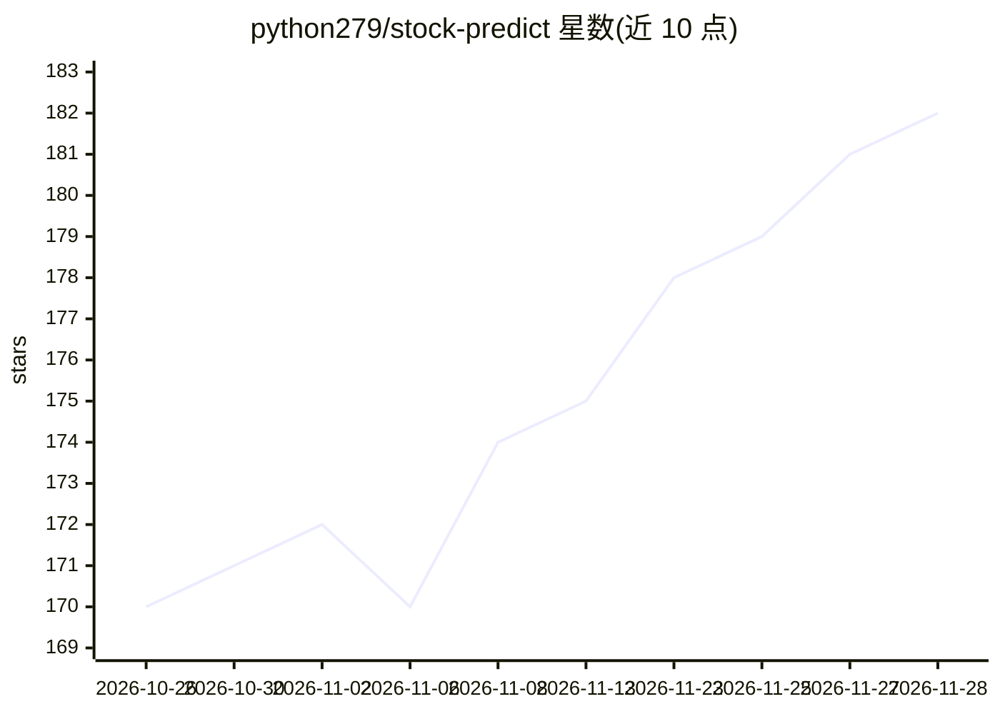

# python279/stock-predict

⭐ 182 · Python · 推送 2026-11-18 · [GitHub](https://github.com/python279/stock-predict) · 个人维护 · 中文 README

**自动抓新闻并用大模型分析股市投资机会的邮件报告系统**

Python 编写的全自动系统：每日从 News API、RSS、GDELT DOC API 与 Google News 抓取新闻，经白名单过滤后送入大模型，结合美股/A股/韩股行情、宏观与官方披露数据，生成含黑天鹅预警、宏观传导、四大市场分析等 7 章报告，以 JSON/Markdown/HTML 邮件输出。支持定时调度与 Cron，运行依赖用户自备 LLM API 密钥和邮箱 SMTP 配置，报告内容为模型输出，README 未提供投资准确性的验证方式。

## 筛选速览

| 维度 | 判定 | 备注 |
|---|---|---|
| AI 角色 | `ai-native` | 本体是模型或模型工具 |
| 许可风险 | `none` | — |
| 部署形态 | `library` | 以包/库形式分发 |
| 模型依赖 | local-ok | 支持本地模型 |
| 硬件要求 | — | 无带数字的原话,不猜 |
| 安装摩擦 | `low` | 无编译、无系统依赖或容器化 |
| 成熟度 | — | 结构信号不足 |

## 能力要点

- 多源新闻抓取：News API、RSS、GDELT、Google News，白名单过滤可信媒体
- 支持 Ollama/OpenAI/Claude/讯飞星火/通义千问等多种 LLM 后端，配置切换
- 覆盖 A股/美股/港股/日股与商品、宏观数据，生成 7 章结构化报告
- 内置调度器与 Cron 部署方式，邮件自动发送 HTML 报告

## 适用场景

- 每天定时收到一份基于国际新闻的市场分析邮件
- 用本地 Ollama 免费跑黑天鹅新闻预警分析
- 跟踪美联储利率、通胀等宏观数据与股市的联动

## 场景标签

`金融量化` · 领域:学习与行业

## 证据(README 行号)

> L5: 完全自动化的国际新闻抓取、分析和通知系统。系统每天自动抓取世界各地的权威新闻源，使用大模型进行深度分析，识别**黑天鹅事件**、预测世界局势并分析 **A股/美股/港股/日股** 投资机会，通过邮件自动发送精美 HTML 格式分析报
> L116: #### 本地 Ollama（默认，免费）
> L179: .venv/bin/python3 src/main.py

## 星数曲线

2026-10-26 170 → 2026-11-28 182（+12）

---
*卡片 v1 · prompt 1.4 · 生成 2026-11-26 · 置信度 high · 依据 README sha `e4dda1d05275` · [字段定义](../../DATASET.md)*
