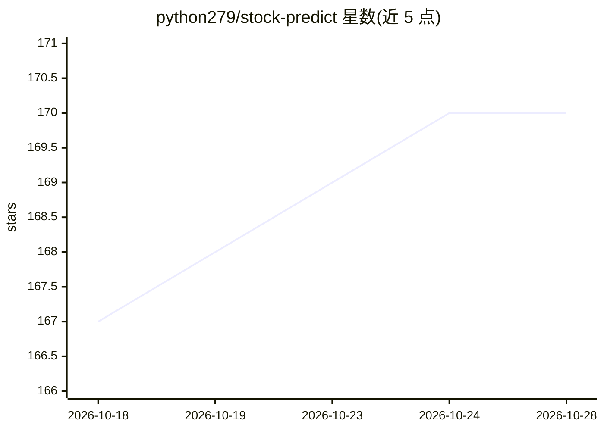

# python279/stock-predict

⭐ 170 · Python · 推送 2026-09-30 · [GitHub](https://github.com/python279/stock-predict) · 个人维护 · 中文 README

**自动抓取全球新闻并用大模型生成投资分析日报的系统**

面向个人投资者的自动化新闻分析系统：每天定时从 News API、RSS、GDELT、Google News 与 IMF 归档抓取新闻，注入美股/A股/港股/日股行情、宏观与大宗商品数据，调用大模型生成固定 7 章节的 HTML 邮件报告，覆盖黑天鹅预警、行业趋势与投资情景。支持 Ollama 本地模型及 OpenAI/OpenAI 兼容/Anthropic 等云端模型，Python 虚拟环境运行，通过配置文件定制，声明仅用于个人研究。

## 筛选速览

| 维度 | 判定 | 备注 |
|---|---|---|
| AI 角色 | `ai-native` | 本体是模型或模型工具 |
| 许可风险 | `none` | — |
| 部署形态 | `library` | 以包/库形式分发 |
| 模型依赖 | local-ok | 支持本地模型 |
| 硬件要求 | — | 无带数字的原话,不猜 |
| 安装摩擦 | `low` | 无编译、无系统依赖或容器化 |
| 成熟度 | — | 结构信号不足 |

## 能力要点

- 多源新闻抓取（News API/RSS/GDELT/Google News/IMF）并按白名单过滤
- 基于历史新闻窗口对比的黑天鹅预警与 T+0~T+3 响应建议
- 默认支持本地 Ollama，免费运行，无需云端 API
- 定时调度自动执行，邮件发送 Markdown 完整渲染的 7 章节报告

## 适用场景

- 每天自动收到覆盖 A股/美股/港股/日股的 AI 分析报告
- 跟踪地缘政治与黑天鹅事件的市场传导信号
- 用本地 Ollama 模型零成本运行个人新闻分析流水线

## 场景标签

`金融量化` · 领域:学习与行业

## 证据(README 行号)

> L5: 完全自动化的国际新闻抓取、分析和通知系统。系统每天自动抓取世界各地的权威新闻源，使用大模型进行深度分析，识别**黑天鹅事件**、预测世界局势并分析 **A股/美股/港股/日股** 投资机会，通过邮件自动发送精美 HTML 格式分析报
> L11: - **智能AI分析**: system/user prompt 分离，强制 Markdown 输出格式
> L182: 系统会：

## 星数曲线

2026-10-18 167 → 2026-10-28 170（+3）

---
*卡片 v1 · prompt 1.4 · 生成 2026-10-22 · 置信度 mid · 依据 README sha `054661d57a0f` · [字段定义](../../DATASET.md)*
