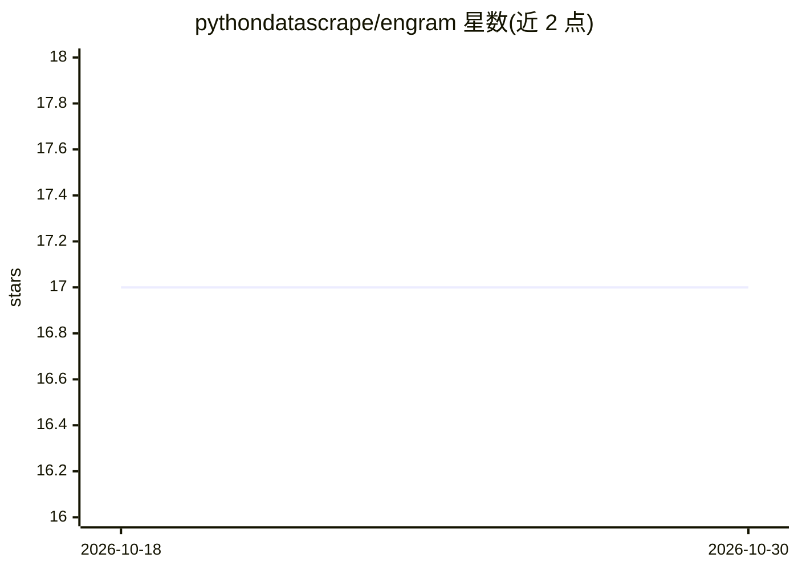

# pythondatascrape/engram

⭐ 17 · JavaScript · NOASSERTION · 推送 2026-10-10 · [GitHub](https://github.com/pythondatascrape/engram) · 个人维护

**本地代理压缩 AI 编码工具的对话上下文以削减冗余 token**

作为本地守护进程与 HTTP 透明代理运行，在 AI 编码工具（Claude Code、OpenClaw）调用 LLM 前压缩对话历史：旧消息折叠为 [CONTEXT_SUMMARY] 块，大体积工具输出经冗余检查后以增量摘要替代。另对 Anthropic 提供 claude-opus/sonnet/haiku-5-5 的服务端工具结果清除，并在 4243 端口暴露 OpenAI 兼容代理。声称上下文压缩约 40-60% token 缩减、内存约 30MB。注意：面向 Anthropic/Claude 的身份压缩（codebook）已禁用，系统提示原样透传；提供 Homebrew 安装与 Python/Go/Node 三语 SDK。

## 筛选速览

| 维度 | 判定 | 备注 |
|---|---|---|
| AI 角色 | `ai-ecosystem` | LLM/agent 周边工具 |
| 许可风险 | `none` | NOASSERTION |
| 部署形态 | `None` |  |
| 模型依赖 | locked-api |  |
| 硬件要求 | — | 无带数字的原话,不猜 |
| 安装摩擦 | `low` | 无编译、无系统依赖或容器化 |
| 成熟度 | — | 结构信号不足 |

## 能力要点

- 本地透明代理将旧对话历史折叠为 [CONTEXT_SUMMARY] 块，保留近期消息原文
- 工具输出冗余检查，支持增量式摘要替代重发
- Anthropic claude-opus/sonnet/haiku-5-5 服务端工具结果清除与 OpenAI 兼容代理（4243 端口）
- engram install 一键安装守护进程、配置与 Claude Code 插件；提供 Python/Go/Node SDK

## 适用场景

- 降低 Claude Code 等 AI 编码工具的重复上下文 token 开销
- 为自定义集成经 SDK 或 OpenAI 兼容代理接入上下文压缩
- 查看会话 token 节省报告与压缩优化建议

## 场景标签

 · 领域:开发者工具/LLM 基础设施

## 证据(README 行号)

> L9: Engram reduces it. It runs locally as a lightweight daemon and compresses your **conversation context** (message his
> L17: 1. **Context compression** — Older conversation history is collapsed into a `[CONTEXT_SUMMARY]` block at the local 
> L111: - `POST /v1/messages` requests are rewritten before upstream so older history becomes a `[CONTEXT_SUMMARY]` block

## 星数曲线

2026-10-18 17 → 2026-10-30 17（+0）

---
*卡片 v1 · prompt 1.4 · 生成 2026-10-29 · 置信度 high · 依据 README sha `9013c3b5a2fb` · [字段定义](../../DATASET.md)*
