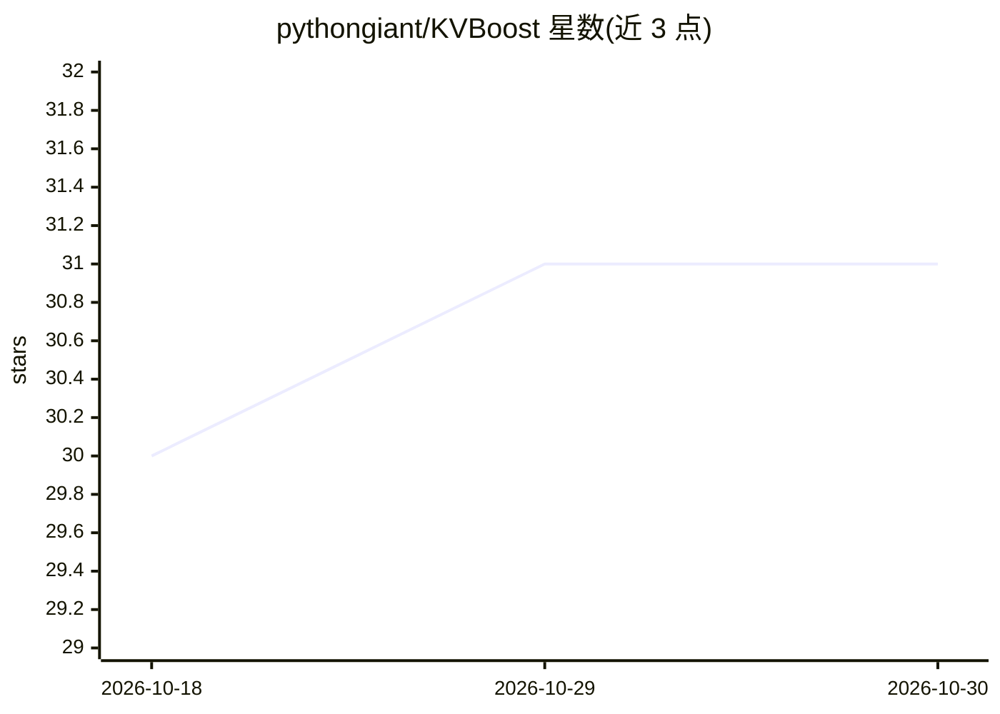

# pythongiant/KVBoost

⭐ 31 · Python · MIT · 推送 2026-07-22 · [GitHub](https://github.com/pythongiant/KVBoost) · [官网](https://pythongiant.github.io/KVBoost/) · 个人维护

**加速本地 LLM 推理的 KV 缓存工具包：跨请求前缀复用**

面向 Hugging Face 因果语言模型的推理优化工具包，以 from_pretrained 包装现有模型，提供内容寻址的跨请求 KV 缓存（块对齐前缀命中）、自定义 FlashAttention-2 CUDA 内核（Volta 至 Hopper）、AWQ 层流式加载（权重超出显存时从主机内存 DMA 流入）与投机解码，并附带 OpenAI 兼容 HTTP 服务器。不改模型、分词器与调用代码即可嵌入现有技术栈。支持 CUDA/MPS/CPU 三后端；基准为 Qwen2.5-3B、RTX 4060 Laptop 8GB 显存上的 ShareGPT 重放。

## 筛选速览

| 维度 | 判定 | 备注 |
|---|---|---|
| AI 角色 | `ai-ecosystem` | LLM/agent 周边工具 |
| 许可风险 | `permissive` | MIT |
| 部署形态 | `library` | 以包/库形式分发 |
| 模型依赖 | — | README 未给出锁定关系 |
| 硬件要求 | `cpu-ok` | |
| 安装摩擦 | `high` | 编译与系统依赖俱全 |
| 成熟度 | — | 结构信号不足 |

## 能力要点

- 内容寻址 KV 缓存跨请求复用块对齐前缀，配 CacheBlend 边界修复保持输出一致
- 自定义 FlashAttention-2 CUDA 内核，未编译时回退到 SDPA
- AWQ 层流式加载可在 12GB GPU 上运行 32B 模型（以吞吐换可运行性）
- OpenAI 兼容服务器（/v1/completions、/v1/chat/completions）与前缀分组异步批处理

## 适用场景

- 多轮对话、agent 循环与 RAG 流水线中削减重复前缀的 prefill 时间
- 用 OpenAI SDK/LangChain/LlamaIndex 等现有客户端直接接入本地加速推理
- 在显存不足的 GPU 上通过层流式加载运行原本放不下的量化模型

## 场景标签

`推理引擎` · 领域:训练与推理

## 证据(README 行号)

> L5:  A practical KV-cache toolkit for Hugging Face causal LMs.
> L6:  Cross-request prefix reuse, a custom FlashAttention-2 kernel, AWQ layer streaming,
> L7:  and speculative decoding behind a drop-in <code>from_pretrained</code> API and an

## 星数曲线

2026-10-18 30 → 2026-10-30 31（+1）

---
*卡片 v1 · prompt 1.4 · 生成 2026-10-26 · 置信度 high · 依据 README sha `d12257bfa19e` · [字段定义](../../DATASET.md)*
