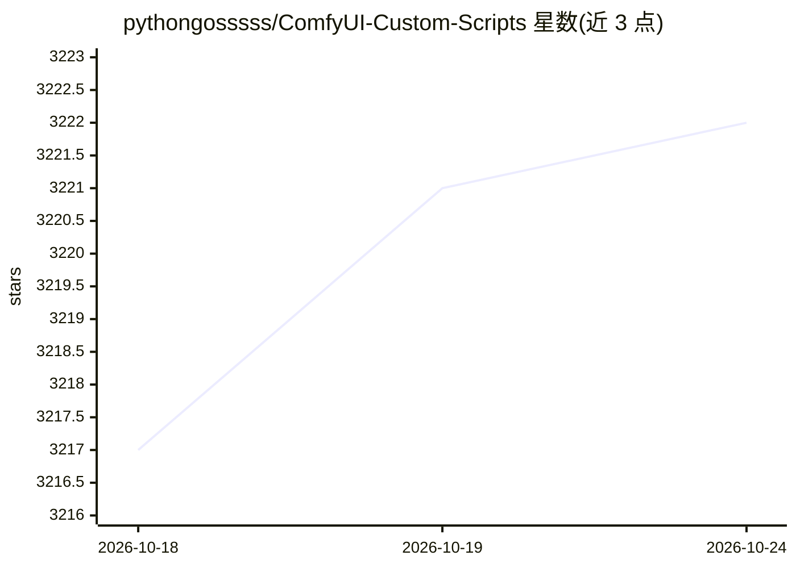

# pythongosssss/ComfyUI-Custom-Scripts

⭐ 3,222 · JavaScript · MIT · 推送 2026-02-12 · [GitHub](https://github.com/pythongosssss/ComfyUI-Custom-Scripts) · 个人维护

**ComfyUI 的 UI 增强与实用节点脚本合集**

面向 ComfyUI 用户的自定义脚本扩展集合，以 UI 功能为主：嵌入词/danbooru 标签自动补全、图自动排列、LoRA/Checkpoint 预览与信息查看、会话图像面板、数学表达式节点、工作流导入导出为 SVG/PNG、系统通知与提示音等，另含 Repeater、Show Text、String Function 等实用节点。通过 git clone 到 custom_nodes 目录安装，脚本自动安装并使用符号链接保持更新。WD14 Tagger 功能已迁移至独立仓库，Lock 功能已并入 ComfyUI 本体。

## 筛选速览

| 维度 | 判定 | 备注 |
|---|---|---|
| AI 角色 | `ai-ecosystem` | LLM/agent 周边工具 |
| 许可风险 | `permissive` | MIT |
| 部署形态 | `None` |  |
| 模型依赖 | — | README 未给出锁定关系 |
| 硬件要求 | — | 无带数字的原话,不猜 |
| 安装摩擦 | `low` | 无编译、无系统依赖或容器化 |
| 成熟度 | — | 结构信号不足 |

## 能力要点

- 嵌入词与自定义词表自动补全（可加载 danbooru 标签）
- 带预览图的 LoRA/Checkpoint 加载器节点
- 支持 INT/FLOAT/IMAGE/LATENT 的数学表达式节点
- 图导出为 SVG/PNG、会话图像面板、系统通知等 UI 功能

## 适用场景

- 为 ComfyUI 补充提示词自动补全与模型预览等界面功能
- 在图中用数学表达式节点组合来自其他节点的数值
- 将工作流图导出为 SVG/PNG 或保存/加载工作流

## 场景标签

 · 领域:AI 图像生成工具/扩展

## 证据(README 行号)

> L1: # ComfyUI-Custom-Scripts
> L9: to your ComfyUI `custom_nodes` directory

## 星数曲线

2026-10-18 3,217 → 2026-10-24 3,222（+5）

---
*卡片 v1 · prompt 1.4 · 生成 2026-10-20 · 置信度 high · 依据 README sha `6d028f03ae2f` · [字段定义](../../DATASET.md)*
