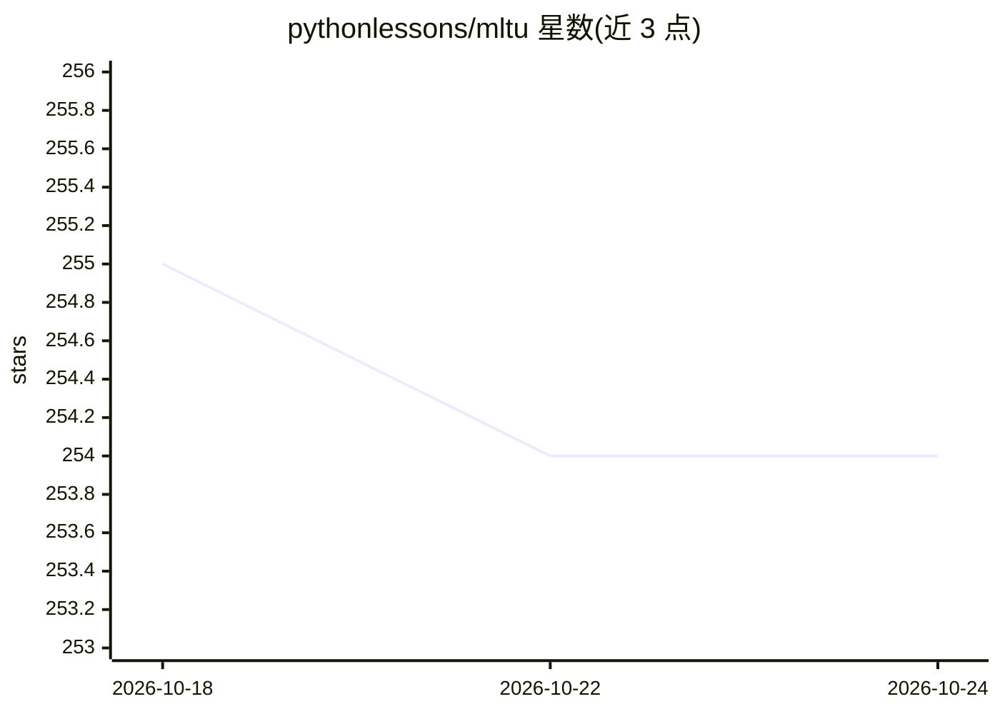

# pythonlessons/mltu

⭐ 254 · Python · MIT · 推送 2026-01-09 · [GitHub](https://github.com/pythonlessons/mltu) · 个人维护

**TensorFlow/PyTorch 机器学习训练工具库，配套教程**

面向 TensorFlow 2.* 与 PyTorch 的训练工具库（MLTU），从 PyPI 以 pip 安装，各教程绑定特定版本号并附独立 requirements.txt。仓库同时组织 12 个教程工程，覆盖文本/手写识别 OCR、验证码识别、语音识别（含 wav2vec2 微调）、翻译 Transformer、YOLOv8 目标检测训练等任务，教程文档发布在 PyLessons.com。新版本可能存在破坏性变更，README 建议教程使用对应版本。

## 筛选速览

| 维度 | 判定 | 备注 |
|---|---|---|
| AI 角色 | `ai-ecosystem` | LLM/agent 周边工具 |
| 许可风险 | `permissive` | MIT |
| 部署形态 | `library` | 以包/库形式分发 |
| 模型依赖 | — | README 未给出锁定关系 |
| 硬件要求 | — | 无带数字的原话,不猜 |
| 安装摩擦 | `low` | 无编译、无系统依赖或容器化 |
| 成熟度 | — | 结构信号不足 |

## 能力要点

- 同时支持 TensorFlow 2.* 与 PyTorch 的训练工具库
- 12 个教程工程：OCR、语音识别、翻译、YOLOv8 目标检测
- 各教程提供独立 requirements.txt 与对应 mltu 版本

## 适用场景

- 跟随教程学习 OCR、语音识别、目标检测的模型训练流程
- 在自己的项目中复用训练与数据处理工具
- 微调 wav2vec2 等模型构建自定义 ASR

## 场景标签

`教程课程` `OCR` `语音识别` `目标检测` · 领域:学习与行业

## 证据(README 行号)

> L1: # MLTU - Machine Learning Training Utilities
> L2: Machine Learning Training Utilities for TensorFlow 2.* and PyTorch with Python 3

## 星数曲线

2026-10-18 255 → 2026-10-24 254（-1）

---
*卡片 v1 · prompt 1.4 · 生成 2026-10-22 · 置信度 high · 依据 README sha `f77e71e091fb` · [字段定义](../../DATASET.md)*
