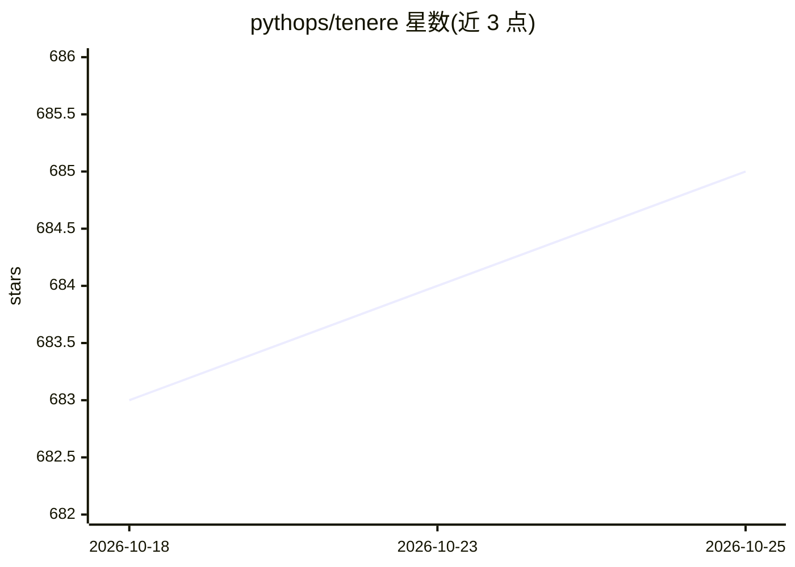

# pythops/tenere

⭐ 685 · Rust · GPL-3.0 · 推送 2026-05-10 · [GitHub](https://github.com/pythops/tenere) · [官网](https://crates.io/crates/tenere) · 个人维护

**Rust 编写的终端 LLM 聊天客户端，支持多后端**

基于 ratatui 的终端界面 LLM 聊天工具：用户在 TUI 中与模型对话，支持 ChatGPT、llama.cpp、ollama 三种后端，通过 TOML 配置文件指定后端 URL、模型名与 API key。提供语法高亮、聊天历史、对话存档、Vim 风格三模式键位（Insert/Normal/Visual）与流式响应中断。安装途径含二进制发布、cargo install、Homebrew、nixpkgs 与源码编译，另可在 Android 上经 nix-on-droid 运行。

## 筛选速览

| 维度 | 判定 | 备注 |
|---|---|---|
| AI 角色 | `ai-ecosystem` | LLM/agent 周边工具 |
| 许可风险 | `viral` | GPL-3.0 |
| 部署形态 | `desktop` | 安装包/桌面程序 |
| 模型依赖 | local-ok | 支持本地模型 |
| 硬件要求 | — | 无带数字的原话,不猜 |
| 安装摩擦 | `medium` | 含编译或系统依赖之一 |
| 成熟度 | — | 结构信号不足 |

## 能力要点

- 三种后端：ChatGPT / llama.cpp / ollama
- Vim 风格三模式键位与可自定义键位绑定
- 聊天历史、对话存档文件与流式响应中断
- TOML 配置文件与 -c 自定义配置路径

## 适用场景

- 在终端中以 Vim 操作习惯与 LLM 对话
- 接入本地 llama.cpp / ollama 服务进行离线聊天
- 保存与回溯历史对话记录

## 场景标签

`聊天机器人` · 领域:对话与助手

## 证据(README 行号)

> L1: TUI for LLMs
> L19: - [x] ChatGPT
> L21: - [x] ollama

## 星数曲线

2026-10-18 683 → 2026-10-25 685（+2）

---
*卡片 v1 · prompt 1.4 · 生成 2026-10-21 · 置信度 high · 依据 README sha `9eb0092f5769` · [字段定义](../../DATASET.md)*
