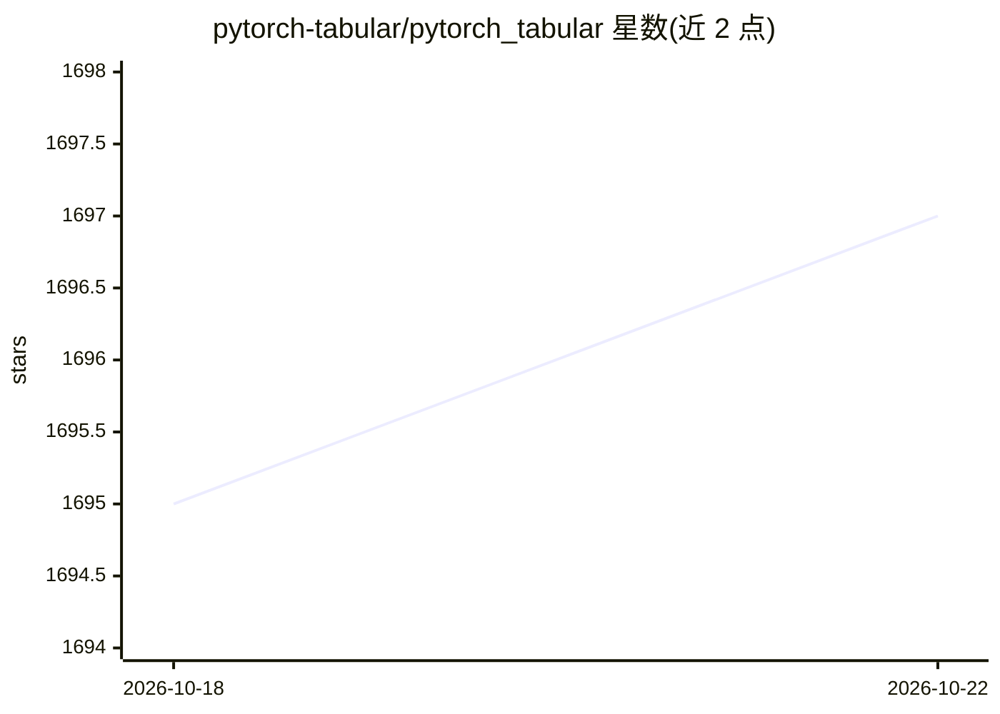

# pytorch-tabular/pytorch_tabular

⭐ 1,697 · Python · MIT · 推送 2026-10-20 · [GitHub](https://github.com/pytorch-tabular/pytorch_tabular) · [官网](https://pytorch-tabular.readthedocs.io/) · 组织维护

**表格数据深度学习的统一框架，基于 PyTorch Lightning**

为表格数据提供统一高层 API 的深度学习框架：内置 Category Embedding FFN、NODE、TabNet、FT Transformer、GANDALF、DANETs 等十余种模型架构，另含去噪自编码器的半监督学习路径。基于 PyTorch 与 PyTorch Lightning 构建，支持 GPU/CPU 训练与自动日志记录；提供自定义模型实现教程。以 pip 安装的 Python 库形式提供，另有 conda 包与 Colab 教程，面向实际业务与研究者两类用户。

## 筛选速览

| 维度 | 判定 | 备注 |
|---|---|---|
| AI 角色 | `ai-ecosystem` | LLM/agent 周边工具 |
| 许可风险 | `permissive` | MIT |
| 部署形态 | `library` | 以包/库形式分发 |
| 模型依赖 | — | README 未给出锁定关系 |
| 硬件要求 | — | 无带数字的原话,不猜 |
| 安装摩擦 | `medium` | 含编译或系统依赖之一 |
| 成熟度 | — | 结构信号不足 |

## 能力要点

- 内置 10 余种表格深度学习架构（NODE/TabNet/FT Transformer/GANDALF 等）
- 基于 PyTorch Lightning 的 GPU/CPU 训练与自动日志
- 半监督学习：去噪自编码器特征表示
- 支持实现自定义模型

## 适用场景

- 在表格数据上快速尝试多种深度学习架构
- 研究论文中训练与对比表格深度学习模型
- 对含噪声数据的半监督特征学习

## 场景标签

 · 领域:机器学习/表格数据

## 证据(README 行号)

> L3: _PyTorch Tabular_ provides a unified interface to deep learning architectures for tabular data. It provides a high-l
> L21: It has been built on the shoulders of giants like **PyTorch**(obviously), and **PyTorch Lightning**.

## 星数曲线

2026-10-18 1,695 → 2026-10-22 1,697（+2）

---
*卡片 v1 · prompt 1.4 · 生成 2026-10-21 · 置信度 high · 依据 README sha `412dbac2467b` · [字段定义](../../DATASET.md)*
