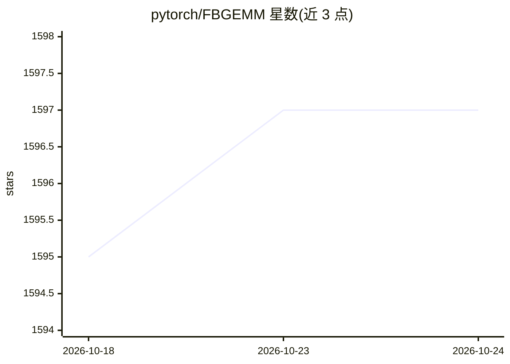

# pytorch/FBGEMM

⭐ 1,597 · C++ · NOASSERTION · 推送 2026-10-23 · [GitHub](https://github.com/pytorch/FBGEMM) · 组织维护

**低精度矩阵乘与卷积内核库，服务服务器端深度学习推理**

由 PyTorch/Meta 维护的三个相关包（FBGEMM、FBGEMM-GPU、FBGEMM-GenAI）组成的内核库集合。FBGEMM 提供 x86 服务器推理用的低精度矩阵乘与卷积内核，支持逐行量化、离群值感知量化与算子融合；FBGEMM_GPU 为推荐系统训练/推理提供 PyTorch GPU 算子；FBGEMM_GPU GenAI 面向生成式 AI（如 FP8 逐行量化、集合通信）。FBGEMM 作为 PyTorch x86 量化算子的后端使用，BSD 许可。社区另有华为昇腾 NPU 移植（fbgemm-ascend）。

## 筛选速览

| 维度 | 判定 | 备注 |
|---|---|---|
| AI 角色 | `ai-ecosystem` | LLM/agent 周边工具 |
| 许可风险 | `none` | NOASSERTION |
| 部署形态 | `library` | 以包/库形式分发 |
| 模型依赖 | — | README 未给出锁定关系 |
| 硬件要求 | — | 无带数字的原话,不猜 |
| 安装摩擦 | `low` | 无编译、无系统依赖或容器化 |
| 成熟度 | — | 结构信号不足 |

## 能力要点

- 低精度矩阵乘/卷积内核，支持逐行量化与离群值感知量化
- 作为 PyTorch x86 量化算子的后端
- 三个包：FBGEMM、FBGEMM-GPU（推荐系统）、FBGEMM-GenAI（FP8 量化/集合通信）
- 社区维护的华为昇腾 NPU 算子移植（fbgemm-ascend）

## 适用场景

- 为推理框架提供低精度 GEMM 后端
- 推荐系统的 PyTorch GPU 训练与推理算子
- 生成式 AI 应用的 FP8 量化与集合通信算子

## 场景标签

`推理引擎` `模型量化` · 领域:训练与推理

## 证据(README 行号)

> L31: FBGEMM (Facebook GEneral Matrix Multiplication) is a low-precision,
> L41: FBGEMM is used as a backend of PyTorch quantized operators for x86 machines:

## 星数曲线

2026-10-18 1,595 → 2026-10-24 1,597（+2）

---
*卡片 v1 · prompt 1.4 · 生成 2026-10-21 · 置信度 high · 依据 README sha `47dbd902a462` · [字段定义](../../DATASET.md)*
