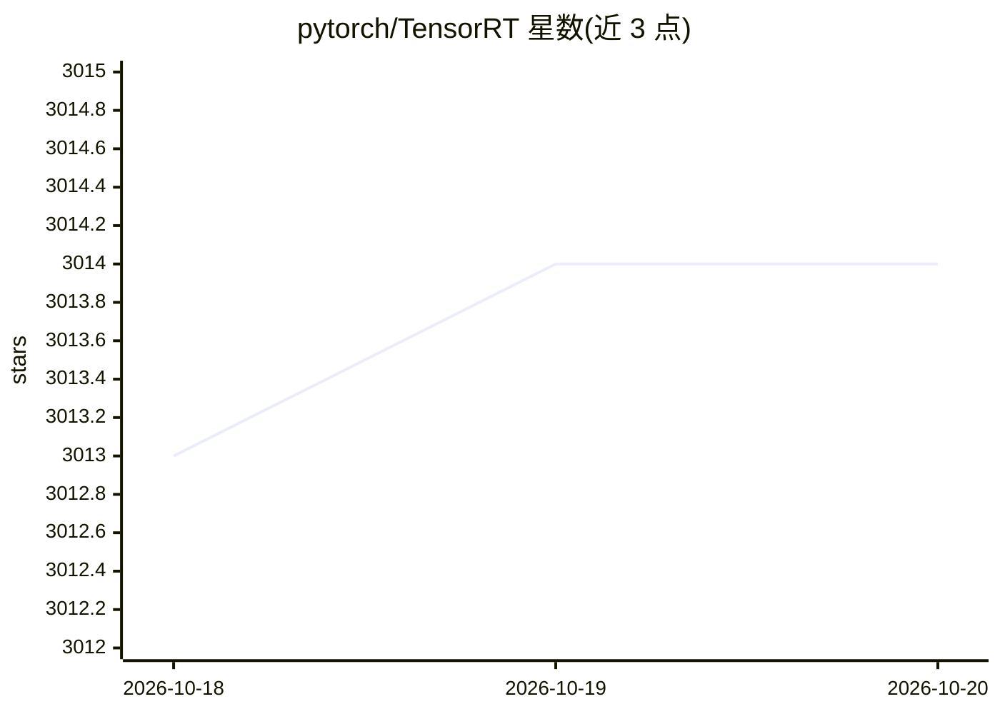

# pytorch/TensorRT

⭐ 3,014 · Python · BSD-3-Clause · 推送 2026-10-19 · [GitHub](https://github.com/pytorch/TensorRT) · [官网](https://pytorch.org/TensorRT) · 组织维护

**面向 NVIDIA GPU 的 PyTorch 编译器，加速模型推理**

Torch-TensorRT 将 TensorRT 引入 PyTorch，通过 torch.compile 一行代码或在导出工作流中编译优化 PyTorch/TorchScript/FX 模型，以降低 NVIDIA GPU 上的推理延迟。支持在 Python 或 C++（libtorch，无 Python 依赖）环境部署序列化后的优化模块。平台覆盖 Linux AMD64/SBSA、Windows（仅 Dynamo）、Jetson（含 DLA，源码编译，JetPack-4.4+）。通过 PyPI、PyTorch nightly 索引或 NVIDIA NGC PyTorch 容器分发，BSD 风格许可。

## 筛选速览

| 维度 | 判定 | 备注 |
|---|---|---|
| AI 角色 | `ai-ecosystem` | LLM/agent 周边工具 |
| 许可风险 | `permissive` | BSD-3-Clause |
| 部署形态 | `library` | 以包/库形式分发 |
| 模型依赖 | — | README 未给出锁定关系 |
| 硬件要求 | — | 无带数字的原话,不猜 |
| 安装摩擦 | `medium` | 含编译或系统依赖之一 |
| 成熟度 | — | 结构信号不足 |

## 能力要点

- 可在任意使用 torch.compile 的位置启用 TensorRT 编译
- 导出式工作流支持序列化优化模块并在 C++（libtorch）环境部署
- 平台支持 Linux AMD64/SBSA、Windows（仅 Dynamo）、Jetson GPU/DLA（源码编译）
- 提供 NGC PyTorch 容器分发，含依赖与示例 notebook

## 适用场景

- 降低已有 PyTorch 模型在 NVIDIA GPU 上的推理延迟
- 将优化后的模型部署到无 Python 依赖的 C++ 环境
- 在 Jetson 设备上运行优化推理

## 场景标签

`推理引擎` · 领域:训练与推理

## 证据(README 行号)

> L2:  Easily achieve the best inference performance for any PyTorch model on the NVIDIA platform.
> L13: Torch-TensorRT brings the power of TensorRT to PyTorch. Accelerate inference latency by up to 5x compared to eager 
> L32: ### Option 1: torch.compile

## 星数曲线

2026-10-18 3,013 → 2026-10-20 3,014（+1）

---
*卡片 v1 · prompt 1.4 · 生成 2026-10-20 · 置信度 high · 依据 README sha `e1ff99c8ceaa` · [字段定义](../../DATASET.md)*
