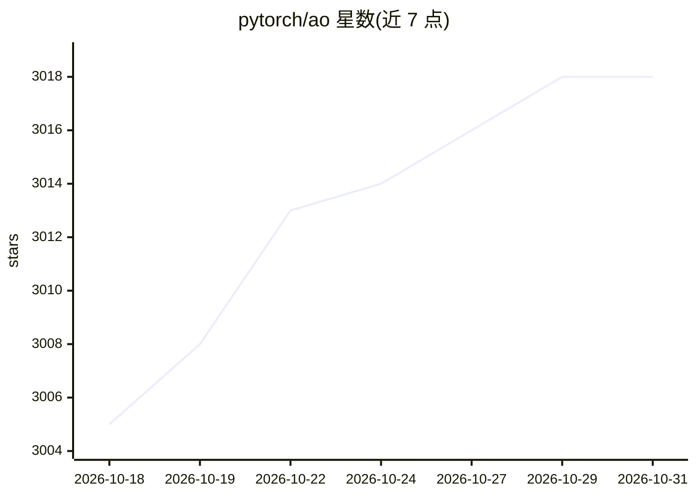

# pytorch/ao

⭐ 3,018 · Python · NOASSERTION · 推送 2026-10-30 · [GitHub](https://github.com/pytorch/ao) · [官网](https://pytorch.org/ao/stable/index.html) · 组织维护

**PyTorch 原生量化库：面向训练与推理的模型优化工具**

PyTorch 官方生态的量化与稀疏化库，覆盖训练到部署全链路：int4/int8/float8 权重与激活量化、量化感知训练（QAT）、float8 训练、量化优化器（AdamW8bit/4bit/Fp8）与 CPU offloading。通过 quantize_ 与 convert_to_float8_training 等 API 使用，兼容 torch.compile 与 FSDP2，被 HuggingFace Transformers/diffusers、vLLM、SGLang、ExecuTorch 等集成。以 pip 安装，面向深度学习开发者。

## 筛选速览

| 维度 | 判定 | 备注 |
|---|---|---|
| AI 角色 | `ai-ecosystem` | LLM/agent 周边工具 |
| 许可风险 | `none` | NOASSERTION |
| 部署形态 | `library` | 以包/库形式分发 |
| 模型依赖 | local-ok | 支持本地模型 |
| 硬件要求 | — | 无带数字的原话,不猜 |
| 安装摩擦 | `medium` | 含编译或系统依赖之一 |
| 成熟度 | — | 结构信号不足 |

## 能力要点

- int4/int8/float8 量化与 QAT，Llama-3 上恢复 96% 量化精度损失
- float8 训练配方，最高 512 GPU/405B 参数规模上达 1.5x 吞吐提升
- 量化优化器与 CPU offloading 降低显存占用
- 集成 vLLM、HuggingFace、ExecuTorch 等推理与训练框架

## 适用场景

- 推理前将模型权重量化为 int4/int8 以降低显存并加速
- 用 QAT 或 LoRA+QAT 恢复低比特量化后的精度
- 以 float8 训练配方加速大规模预训练
- 通过 ExecuTorch 部署量化模型到 iPhone 等边缘设备

## 场景标签

`模型量化` `模型训练` · 领域:训练与推理

## 证据(README 行号)

> L37: TorchAO is an easy to use quantization library for native PyTorch. TorchAO works out-of-the-box with `torch.compile
> L158: torchao.float8 implements training recipes with the scaled float8 dtypes, as laid out in https://arxiv.org/abs/220
> L194: ## 🔗 Integrations

## 星数曲线

2026-10-18 3,005 → 2026-10-31 3,018（+13）

---
*卡片 v1 · prompt 1.4 · 生成 2026-10-20 · 置信度 high · 依据 README sha `886813b39716` · [字段定义](../../DATASET.md)*
