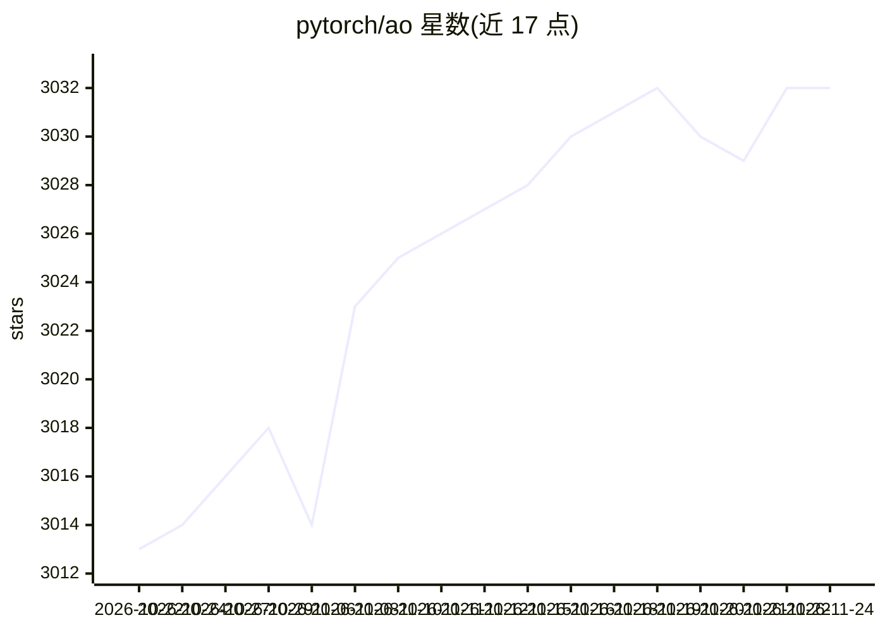

# pytorch/ao

⭐ 3,032 · Python · NOASSERTION · 推送 2026-11-22 · [GitHub](https://github.com/pytorch/ao) · [官网](https://pytorch.org/ao/stable/index.html) · 组织维护

**PyTorch 原生量化库：为训练与推理提供低精度量化工作流**

TorchAO 是面向原生 PyTorch 的量化库，提供 int4/int8/float8/MXFP8 等低精度量化的训练与推理工作流，兼容 torch.compile 与 FSDP2，包含量化感知训练（QAT）、量化优化器与 CPU offloading 等功能，并通过 ExecuTorch 支持边缘设备部署。README 声明其新功能开发正在减少，低层原语将并入 torch、高层工作流并入使用方仓库（如 torchtitan），现有工作流将持续维护以兼容未来的 torch 版本。

## 筛选速览

| 维度 | 判定 | 备注 |
|---|---|---|
| AI 角色 | `ai-native` | 本体是模型或模型工具 |
| 许可风险 | `none` | NOASSERTION |
| 部署形态 | `library` | 以包/库形式分发 |
| 模型依赖 | local-ok | 支持本地模型 |
| 硬件要求 | — | 无带数字的原话,不猜 |
| 安装摩擦 | `medium` | 含编译或系统依赖之一 |
| 成熟度 | — | 结构信号不足 |

## 能力要点

- 提供 int4/int8/float8/MXFP8 量化的推理与训练工作流
- 支持 QAT、量化优化器（AdamW8bit/4bit/Fp8）与 CPU offloading
- 兼容 torch.compile 与 FSDP2，支持 ExecuTorch 边缘部署
- 作为 transformers、diffusers、vLLM、torchtitan 等库的量化后端集成

## 适用场景

- 对 Llama 类模型做 int4/float8 量化以降低推理显存占用
- 在预训练中启用 float8 量化训练流程
- 用 QAT 恢复量化后的模型精度
- 通过 ExecuTorch 把量化模型部署到手机等边缘设备

## 场景标签

`模型量化` · 领域:训练与推理

## 证据(README 行号)

> L51: TorchAO is an easy to use quantization library for native PyTorch. TorchAO works out-of-the-box with `torch.compile
> L69: Quantize your model weights to int4!
> L172: torchao.float8 implements training recipes with the scaled float8 dtypes, as laid out in https://arxiv.org/abs/220

## 星数曲线

2026-10-22 3,013 → 2026-11-24 3,032（+19）

---
*卡片 v1 · prompt 1.4 · 生成 2026-11-23 · 置信度 high · 依据 README sha `943aeb4eceaa` · [字段定义](../../DATASET.md)*
