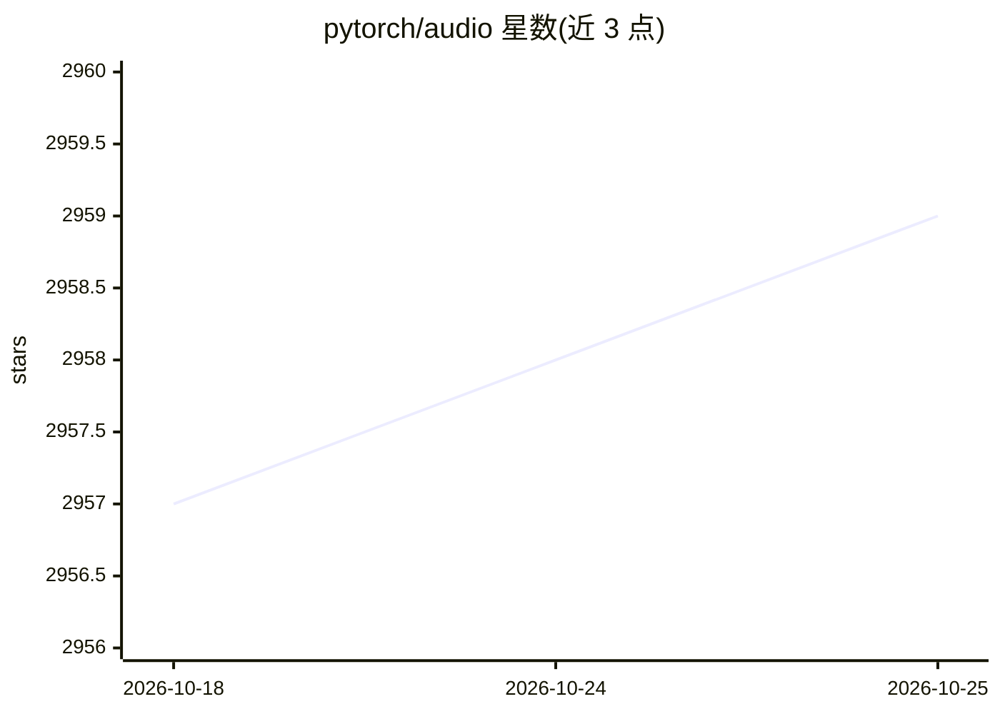

# pytorch/audio

⭐ 2,960 · Python · BSD-2-Clause · 推送 2026-10-25 · [GitHub](https://github.com/pytorch/audio) · [官网](https://pytorch.org/audio) · 组织维护

**PyTorch 生态的音频与语音处理库，供 ML 开发者使用**

面向 PyTorch 用户的音频域机器学习库：提供常见音频数据集的 Dataloaders、音频与语音处理函数（如 forced_align）、常用变换（Spectrogram、MelSpectrogram、MFCC、Resample 等），以及与 Kaldi 对齐的兼容接口。计算通过 PyTorch 操作实现，支持 GPU 加速与 autograd 可训练特征。自述定位为机器学习库而非通用信号处理库。项目已进入维护阶段，2.8 起弃用、2.9 移除了部分用户可见功能，范围收敛于为 ML 处理音频数据。

## 筛选速览

| 维度 | 判定 | 备注 |
|---|---|---|
| AI 角色 | `ai-ecosystem` | LLM/agent 周边工具 |
| 许可风险 | `permissive` | BSD-2-Clause |
| 部署形态 | `library` | 以包/库形式分发 |
| 模型依赖 | — | README 未给出锁定关系 |
| 硬件要求 | — | 无带数字的原话,不猜 |
| 安装摩擦 | `low` | 无编译、无系统依赖或容器化 |
| 成熟度 | — | 结构信号不足 |

## 能力要点

- 常见音频数据集的 Dataloaders
- Spectrogram/MelSpectrogram/MFCC/Resample 等常用音频变换
- forced_align 等语音处理函数与 Kaldi 兼容接口
- 计算全部基于 PyTorch 操作，支持 GPU 加速与 autograd

## 适用场景

- 为语音识别模型准备频谱特征数据
- 在 PyTorch 训练管线中加载常见音频数据集
- 复用 Kaldi 风格特征（fbank/mfcc）的计算逻辑

## 场景标签

 · 领域:音频/语音机器学习

## 证据(README 行号)

> L27: The aim of torchaudio is to apply PyTorch to
> L31: Therefore, it is primarily a machine learning library and not a general signal

## 星数曲线

2026-10-18 2,957 → 2026-10-25 2,959（+2）

---
*卡片 v1 · prompt 1.4 · 生成 2026-10-21 · 置信度 high · 依据 README sha `67ef421476d8` · [字段定义](../../DATASET.md)*
