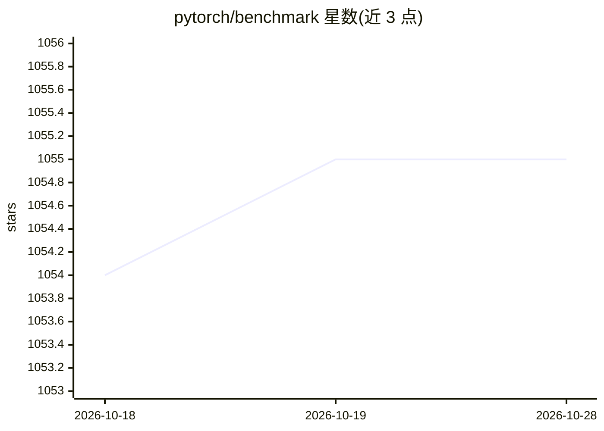

# pytorch/benchmark

⭐ 1,055 · Python · BSD-3-Clause · 推送 2026-10-23 · [GitHub](https://github.com/pytorch/benchmark) · 组织维护

**PyTorch 官方模型基准测试套件：评估 PyTorch 性能**

TorchBench 收集开源基准工作负载用于评估 PyTorch 性能：torchbenchmark/models 内含修改过的流行模型，暴露标准化 API、可选启用 torchinductor/torchscript 后端，并附带微型训练/测试数据与依赖安装脚本。支持 test.py 冒烟运行、pytest-benchmark 驱动、userbenchmark 自定义基准、run.py 调试与 profiling，也可作为 Python 库导入。建议使用 PyTorch nightly 版本，稳定版未测试维护；低噪声调优目前仅自动化支持 AWS g4dn.metal Amazon Linux。

## 筛选速览

| 维度 | 判定 | 备注 |
|---|---|---|
| AI 角色 | `ai-ecosystem` | LLM/agent 周边工具 |
| 许可风险 | `permissive` | BSD-3-Clause |
| 部署形态 | `library` | 以包/库形式分发 |
| 模型依赖 | — | README 未给出锁定关系 |
| 硬件要求 | — | 无带数字的原话,不猜 |
| 安装摩擦 | `medium` | 含编译或系统依赖之一 |
| 成熟度 | — | 结构信号不足 |

## 能力要点

- 标准化 API 的模型基准集合，可启用 torchinductor/torchscript 后端
- 提供 test.py / test_bench.py / userbenchmark / run.py 多种运行方式
- 可作为库导入单个模型进行 CI 或测试
- 提供低噪声机器自动调优脚本（当前支持 g4dn.metal Amazon Linux）

## 适用场景

- 对比不同 PyTorch 版本或后端的模型性能
- 在 CI 中引入基准模型做回归测试
- 调试或 profiling 特定模型的训练/推理过程

## 场景标签

`模型评测` · 领域:评测与运维

## 证据(README 行号)

> L2: This is a collection of open source benchmarks used to evaluate PyTorch performance.
> L104: `test.py` offers the simplest wrapper around the infrastructure for iterating through each model and installing an
> L106: `test_bench.py` is a pytest-benchmark script that leverages the same infrastructure but collects benchmark statist

## 星数曲线

2026-10-18 1,054 → 2026-10-28 1,055（+1）

---
*卡片 v1 · prompt 1.4 · 生成 2026-10-21 · 置信度 high · 依据 README sha `49b740a35de5` · [字段定义](../../DATASET.md)*
