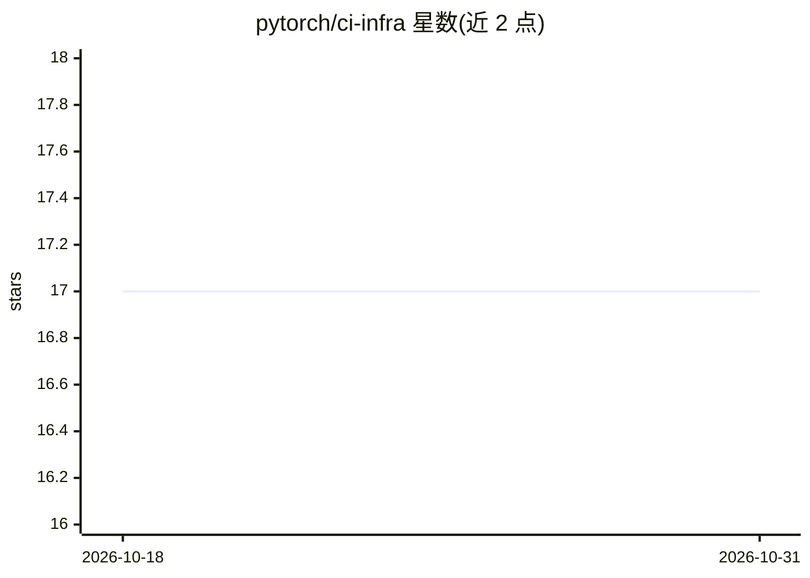

# pytorch/ci-infra

⭐ 17 · Python · NOASSERTION · 推送 2026-10-30 · [GitHub](https://github.com/pytorch/ci-infra) · 组织维护

**PyTorch 项目 CI 基础设施：EC2 自动扩缩容的 Terraform 配置**

存放 PyTorch 基于 Lambda 的 EC2 实例自动扩缩容器的 Terraform 配置，为 github.com/pytorch/pytorch 项目驱动 GitHub Actions 自托管 runner，使用 PyTorch 基金会的云服务账户。README 同时汇总相关工作组与文档入口：test-infra 测试基础设施、Datadog 监控的 Terraform 配置、CI 工作组、多云工作组、PyTorch HUD 及 CI/CD 安全原则。README 未给出本仓库的安装或运行命令。

## 筛选速览

| 维度 | 判定 | 备注 |
|---|---|---|
| AI 角色 | `ai-ecosystem` | LLM/agent 周边工具 |
| 许可风险 | `none` | NOASSERTION |
| 部署形态 | `None` |  |
| 模型依赖 | — | README 未给出锁定关系 |
| 硬件要求 | — | 无带数字的原话,不猜 |
| 安装摩擦 | `low` | 无编译、无系统依赖或容器化 |
| 成熟度 | — | 结构信号不足 |

## 能力要点

- 提供 PyTorch CI 自动扩缩容器的 Terraform 配置
- 驱动 GitHub Actions 自托管 runner（基于 AWS）
- 汇总 test-infra、监控、多云工作组等文档入口

## 适用场景

- 了解或参与 PyTorch CI 自托管 runner 的基础设施维护
- 为 PyTorch 项目贡献 CI runner
- 查阅 PyTorch CI/多云工作组的架构与指南

## 场景标签

 · 领域:CI/CD 基础设施

## 证据(README 行号)

> L3: The PyTorch ci-infra repo contains the terraform configuration for the PyTorch
> L8: The PyTorch CI infrastructure is for the use of the github.com/pytorch/pytorch
> L9: project. It powers GitHub Actions self-hosted runners from the PyTorch

## 星数曲线

2026-10-18 17 → 2026-10-31 17（+0）

---
*卡片 v1 · prompt 1.4 · 生成 2026-10-29 · 置信度 mid · 依据 README sha `f76b1c0ea471` · [字段定义](../../DATASET.md)*
