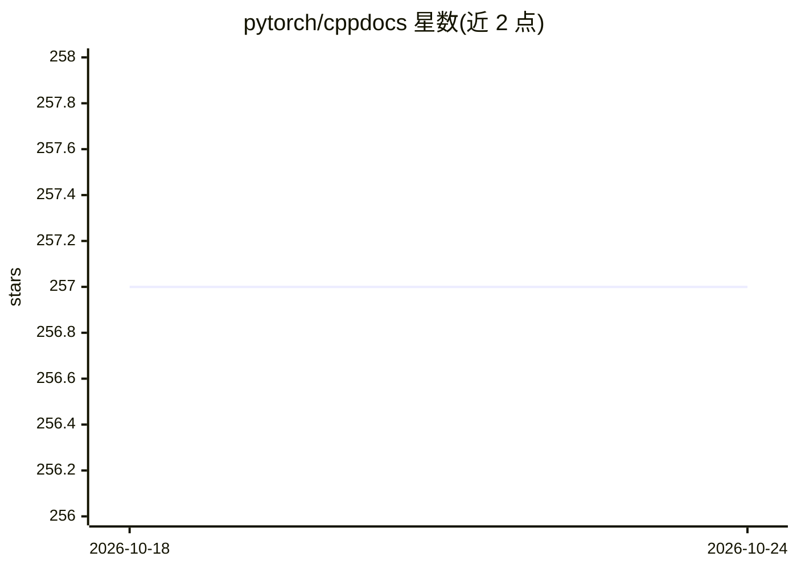

# pytorch/cppdocs

⭐ 257 · HTML · 推送 2026-10-23 · [GitHub](https://github.com/pytorch/cppdocs) · [官网](https://pytorch.org/cppdocs) · 组织维护

**PyTorch C++ API 文档网站的自动生成源码仓库**

存放 pytorch.org/cppdocs 网站源码的自动生成仓库，内容为 PyTorch C++ API 的教程与源码级文档。README 明确不接受 PR：教程与笔记需修改 pytorch 主仓库的 docs/cpp/source，源码级文档需修改 PyTorch 源码，本仓库会在下次自动同步时被覆盖。面向需要查阅 PyTorch C++ API 文档的开发者，本身不含产品安装或运行方式。

## 筛选速览

| 维度 | 判定 | 备注 |
|---|---|---|
| AI 角色 | `ai-knowledge` | 知识聚合/清单类 |
| 许可风险 | `none` | — |
| 部署形态 | `None` |  |
| 模型依赖 | — | README 未给出锁定关系 |
| 硬件要求 | — | 无带数字的原话,不猜 |
| 安装摩擦 | `low` | 无编译、无系统依赖或容器化 |
| 成熟度 | — | 结构信号不足 |

## 能力要点

- 自动生成的 PyTorch C++ API 文档网站源码
- 指向 pytorch 主仓库的文档修改路径
- 不接受针对本仓库的 PR，变更会被自动同步覆盖

## 适用场景

- 查阅 PyTorch C++ API 的教程与参考文档
- 定位需要修改的文档源文件位置

## 场景标签

 · 领域:深度学习框架文档

## 证据(README 行号)

> L3: This repository is automatically generated to contain the website source for the
> L4: PyTorch C++ API documentation at https://pytorch.org/cppdocs.

## 星数曲线

2026-10-18 257 → 2026-10-24 257（+0）

---
*卡片 v1 · prompt 1.4 · 生成 2026-10-22 · 置信度 high · 依据 README sha `8da62c58bc1a` · [字段定义](../../DATASET.md)*
