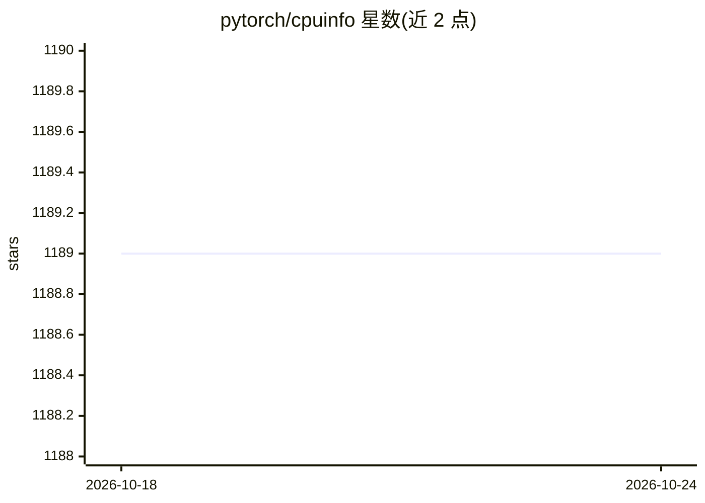

# pytorch/cpuinfo

⭐ 1,189 · C · BSD-2-Clause · 推送 2026-07-30 · [GitHub](https://github.com/pytorch/cpuinfo) · 组织维护

**跨平台 CPU 信息检测 C/C++ 库：供性能优化读取指令集/缓存/拓扑**

cpuinfo 是一个 C/C++ 库，用于检测主机 CPU 上对性能优化关键的信息：支持的指令集（至 AVX512 与 ARMv8.3 扩展）、SoC 与核心型号/微架构、缓存层级参数、逻辑处理器-核心-封装拓扑。接口线程安全、初始化后无内存分配、不抛异常，支持异构核心（big.LITTLE）。覆盖 Linux/Windows/macOS/iOS/Android/FreeBSD 与 x86/ARM 架构，通过 CMake、Bazel、pkg-config 等方式集成到下游构建系统。CPU 频率与 TLB 信息暂未暴露。

## 筛选速览

| 维度 | 判定 | 备注 |
|---|---|---|
| AI 角色 | `ai-ecosystem` | LLM/agent 周边工具 |
| 许可风险 | `permissive` | BSD-2-Clause |
| 部署形态 | `None` |  |
| 模型依赖 | — | README 未给出锁定关系 |
| 硬件要求 | — | 无带数字的原话,不猜 |
| 安装摩擦 | `medium` | 含编译或系统依赖之一 |
| 成熟度 | — | 结构信号不足 |

## 能力要点

- 检测指令集支持至 AVX512（x86）与 ARMv8.3 扩展
- 缓存参数与逻辑处理器/核心/封装拓扑检测
- 支持异构核心（big.LITTLE、Max.Med.Min）
- 跨 6 类 OS 与 x86/x86-64/ARM/ARM64 架构

## 适用场景

- 运行时按 CPU 指令集分发优化内核（如 AVX/NEON 路径选择）
- 按缓存拓扑做线程绑核
- 识别 SoC 型号与各核微架构以做性能调优

## 场景标签

 · 领域:系统库/硬件信息检测

## 证据(README 行号)

> L7: cpuinfo is a library to detect essential for performance optimization information about host CPU.

## 星数曲线

2026-10-18 1,189 → 2026-10-24 1,189（+0）

---
*卡片 v1 · prompt 1.4 · 生成 2026-10-21 · 置信度 low · 依据 README sha `fcc1983485ca` · [字段定义](../../DATASET.md)*
