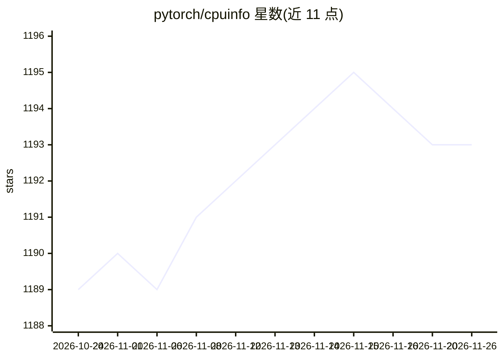

# pytorch/cpuinfo

⭐ 1,193 · C · BSD-2-Clause · 推送 2026-11-19 · [GitHub](https://github.com/pytorch/cpuinfo) · 组织维护

**给开发者用的主机 CPU 信息检测 C 库**

一个检测宿主机 CPU 性能相关信息的 C/C++ 库：识别处理器（SoC）名称、各核心的厂商与微架构、支持的指令集（x86 最高 AVX512、ARM 最高 ARMv8.3 扩展）、缓存结构与拓扑关系，支持异构核心（big.LITTLE）。跨 Linux/Windows/macOS/Android/iOS/FreeBSD 与 x86/x86-64/ARM/ARM64 架构运行，线程安全、初始化后无内存分配、不抛异常。默认生成 pkg-config 清单，可经 CMake、Meson、Bazel、Autotools 等方式集成，代码含 60+ 基于真实设备数据的 mock 测试。

## 筛选速览

| 维度 | 判定 | 备注 |
|---|---|---|
| AI 角色 | `ai-enhanced` | 去掉 AI 部分产品仍成立 |
| 许可风险 | `permissive` | BSD-2-Clause |
| 部署形态 | `None` |  |
| 模型依赖 | — | README 未给出锁定关系 |
| 硬件要求 | — | 无带数字的原话,不猜 |
| 安装摩擦 | `medium` | 含编译或系统依赖之一 |
| 成熟度 | — | 结构信号不足 |

## 能力要点

- 检测指令集支持：x86 最高 AVX512，ARM 最高 ARMv8.3 扩展
- 识别 SoC 名称与每个核心的厂商、微架构（含 MIDR/CPUID ID）
- 提供缓存类型、大小、关联度与共享拓扑信息
- 支持 big.LITTLE 等异构核心系统，跨 6 种操作系统 4 种架构

## 适用场景

- 性能优化前探测宿主机支持的指令集与缓存结构
- 移动端按 SoC 与核心微架构做运行时分支
- 按缓存共享关系将线程绑定到对应核心

## 场景标签

 · 领域:系统库/硬件信息检测

## 证据(README 行号)

> L7: cpuinfo is a library to detect essential for performance optimization information about host CPU.
> L11: - **Cross-platform** availability:

## 星数曲线

2026-10-24 1,189 → 2026-11-26 1,193（+4）

---
*卡片 v1 · prompt 1.4 · 生成 2026-11-23 · 置信度 high · 依据 README sha `5790d6ff8eba` · [字段定义](../../DATASET.md)*
