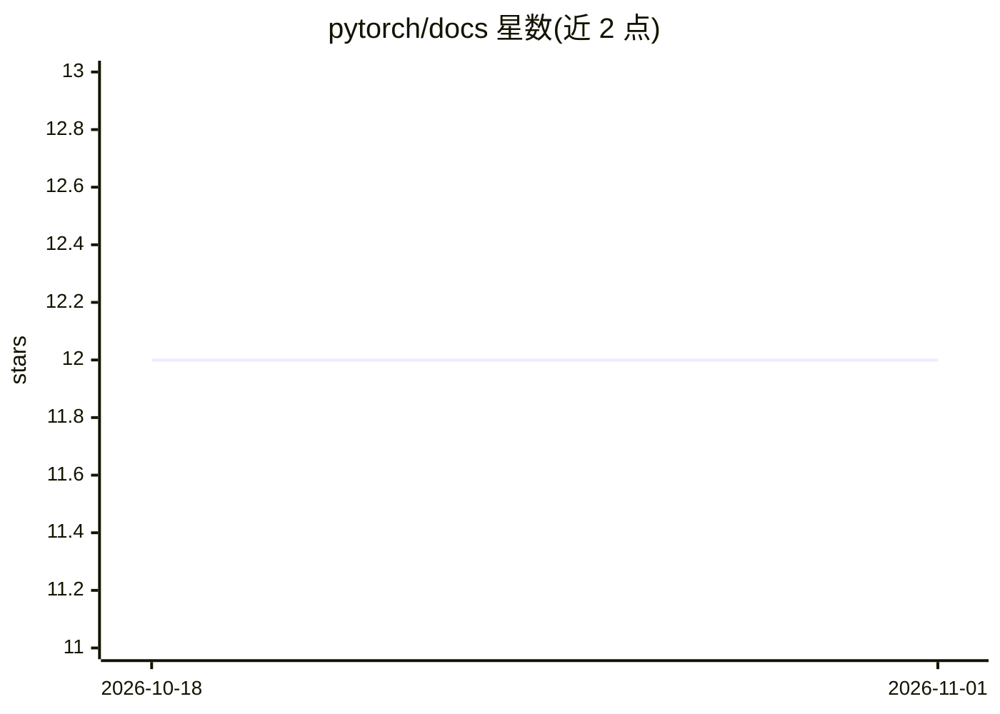

# pytorch/docs

⭐ 12 · HTML · BSD-3-Clause · 推送 2026-10-31 · [GitHub](https://github.com/pytorch/docs) · 组织维护

**PyTorch 官方文档网站的自动生成源码仓库**

由 PyTorch 项目自动生成的仓库，内容为 pytorch.org/docs 文档网站的网站源码。README 明确说明不接受针对本仓库的 PR：文档修改需在 PyTorch 源码中的文档处进行，本仓库的改动会在下次自动同步时被覆盖。许可证为 BSD，见仓库内 LICENSE 文件。本仓库不提供安装或运行说明，仅作为文档网站的发布载体。

## 筛选速览

| 维度 | 判定 | 备注 |
|---|---|---|
| AI 角色 | `ai-knowledge` | 知识聚合/清单类 |
| 许可风险 | `permissive` | BSD-3-Clause |
| 部署形态 | `None` |  |
| 模型依赖 | — | README 未给出锁定关系 |
| 硬件要求 | — | 无带数字的原话,不猜 |
| 安装摩擦 | `low` | 无编译、无系统依赖或容器化 |
| 成熟度 | — | 结构信号不足 |

## 能力要点

- 存放 PyTorch 官方文档（pytorch.org/docs）的网站源码
- 由上游自动生成并定期同步
- 文档修改需提交到 PyTorch 主仓库，本仓库不接受 PR

## 适用场景

- 查阅 PyTorch 官方文档网站的源码结构
- 了解 PyTorch 文档的发布方式

## 场景标签

 · 领域:深度学习框架/文档

## 证据(README 行号)

> L1: This repository is automatically generated to contain the website source for the PyTorch documentation at https://py

## 星数曲线

2026-10-18 12 → 2026-11-01 12（+0）

---
*卡片 v1 · prompt 1.4 · 生成 2026-11-01 · 置信度 mid · 依据 README sha `e0f0c51cf43b` · [字段定义](../../DATASET.md)*
