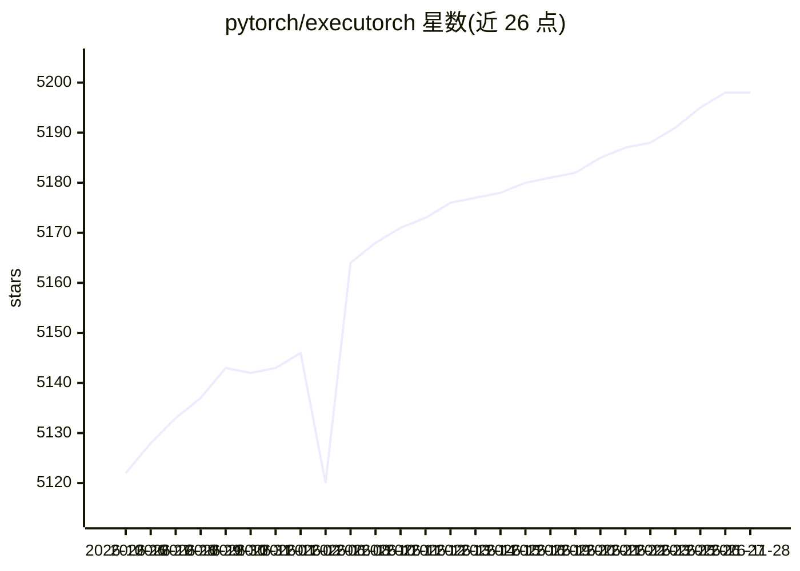

# pytorch/executorch

⭐ 5,198 · Python · NOASSERTION · 推送 2026-11-27 · [GitHub](https://github.com/pytorch/executorch) · [官网](https://executorch.ai) · 组织维护

**让开发者在手机/嵌入式设备本地运行 PyTorch AI 模型的运行时**

ExecuTorch 是 PyTorch 官方的端侧推理栈：从 `torch.export` 捕获模型，针对目标硬件优化为 `.pte` 文件，通过 C++/Python/Swift/Kotlin/JavaScript 等 API 在手机、浏览器、可穿戴设备与微控制器上本地执行。机制上支持按算子裁剪运行时（selective build）、将计算图分区委托给 CPU/GPU/NPU/DSP 后端并提供 CPU 回退、版本化的运行时兼容契约。Python 包支持 Python 3.11–3.15，Linux 预编译 wheel 为 CUDA 构建。

## 筛选速览

| 维度 | 判定 | 备注 |
|---|---|---|
| AI 角色 | `ai-ecosystem` | LLM/agent 周边工具 |
| 许可风险 | `none` | NOASSERTION |
| 部署形态 | `library` | 以包/库形式分发 |
| 模型依赖 | local-ok | 支持本地模型 |
| 硬件要求 | `cpu-ok` | |
| 安装摩擦 | `high` | 编译与系统依赖俱全 |
| 成熟度 | — | 结构信号不足 |

## 能力要点

- torch.export 捕获模型并导出为后端专用的 .pte 文件
- 计算图分区委托到 CPU/GPU/NPU/DSP 后端，保留便携 CPU 内核回退
- selective build 只链接部署所需算子与内核
- 多语言运行时 API：C++、Python、Kotlin/Java、Swift/Objective-C、JavaScript/WebAssembly

## 适用场景

- 在 Android/iOS 应用中本地运行量化 LLM 与多模态模型
- 为 Cortex-M/ESP32 等微控制器部署语音识别或视觉模型
- 在浏览器中通过 WebAssembly/WebGPU 执行 PyTorch 模型
- 面向 Meta Quest 类设备构建端侧 AI 功能

## 场景标签

`推理引擎` · 领域:训练与推理

## 证据(README 行号)

> L11: **ExecuTorch** is PyTorch's open source stack for running AI locally on phones,
> L53: - **Partitioned hardware acceleration:** delegate supported graph regions to
> L59: - **A runtime you can right-size:** link only the operators, kernels, and

## 星数曲线

2026-10-26 5,122 → 2026-11-28 5,198（+76）

---
*卡片 v1 · prompt 1.4 · 生成 2026-11-22 · 置信度 high · 依据 README sha `ce8561e86a05` · [字段定义](../../DATASET.md)*
