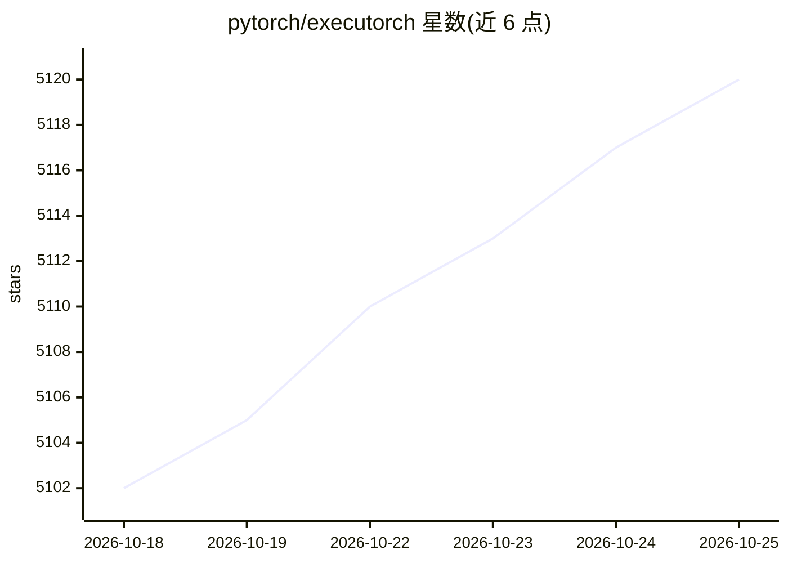

# pytorch/executorch

⭐ 5,122 · Python · NOASSERTION · 推送 2026-10-25 · [GitHub](https://github.com/pytorch/executorch) · [官网](https://executorch.ai) · 组织维护

**PyTorch 官方端侧 AI 推理栈：在手机、嵌入式与边缘设备本地运行模型**

Meta/PyTorch 维护的开源端侧推理栈：从 PyTorch 模型出发，经 torch.export 捕获、按目标硬件优化，生成后端专属 .pte 文件，通过 C++/Python/Swift/Kotlin/JavaScript 等 API 在手机、可穿戴、笔记本、浏览器、嵌入式与微控制器上运行。支持委托 CPU/GPU/NPU/DSP 后端加速、选择性构建裁剪运行时，覆盖本地 LLM、语音、多模态与计算机视觉工作负载。已用于 Instagram、WhatsApp、Meta Quest 等产品；预编译 wheel 仅覆盖 Linux/macOS/Windows 部分架构，其他主机需源码构建。

## 筛选速览

| 维度 | 判定 | 备注 |
|---|---|---|
| AI 角色 | `ai-ecosystem` | LLM/agent 周边工具 |
| 许可风险 | `none` | NOASSERTION |
| 部署形态 | `library` | 以包/库形式分发 |
| 模型依赖 | — | README 未给出锁定关系 |
| 硬件要求 | — | 无带数字的原话,不猜 |
| 安装摩擦 | `high` | 编译与系统依赖俱全 |
| 成熟度 | `idea` | |

## 能力要点

- torch.export 导出 + 按后端生成 .pte 的硬件专属部署流程
- 委托 CPU/GPU/NPU/DSP 多后端加速并保留 CPU 内核回退
- 选择性构建仅链接所需算子内核，可裁剪运行时体积
- C++/Python/Swift/Kotlin/JavaScript 多语言运行时 API

## 适用场景

- 把训练好的 PyTorch 模型部署到 Android/iOS 应用中本地推理
- 在 Cortex-M、Ethos-U 等嵌入式/MCU 设备上运行 AI 模型
- 在手机端运行量化 LLM 的文本生成与语音识别

## 场景标签

`推理引擎` · 领域:训练与推理

## 证据(README 行号)

> L11: **ExecuTorch** is PyTorch's open source stack for running AI locally on phones,
> L14: and run it through C++, Python, Swift/Objective-C, Kotlin/Java, or JavaScript
> L164: Choose a backend based on target hardware, operator coverage, and deployment

## 星数曲线

2026-10-18 5,102 → 2026-10-25 5,120（+18）

---
*卡片 v1 · prompt 1.4 · 生成 2026-10-20 · 置信度 high · 依据 README sha `67178cc82e30` · [字段定义](../../DATASET.md)*
