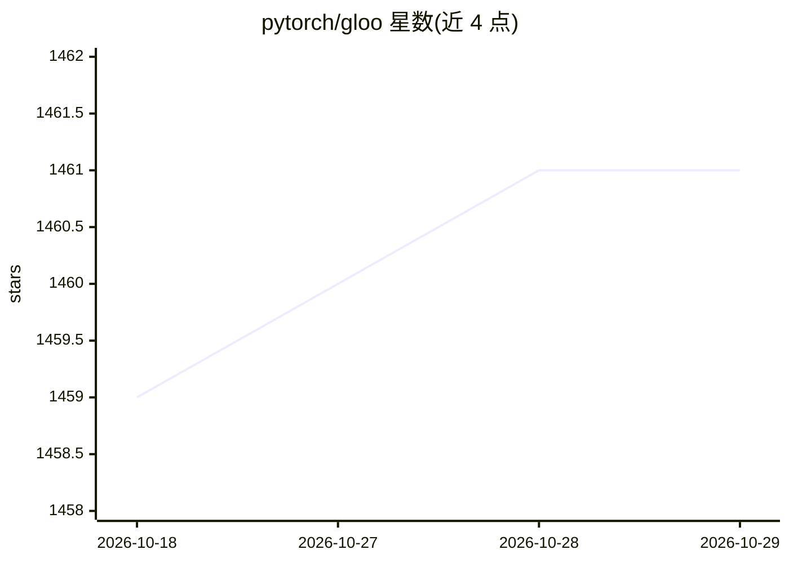

# pytorch/gloo

⭐ 1,461 · C++ · NOASSERTION · 推送 2026-10-01 · [GitHub](https://github.com/pytorch/gloo) · [官网](https://pytorch.org/docs/stable/distributed.html) · 组织维护

**面向多机训练的集合通信库：提供 barrier/broadcast/allreduce 等原语**

Gloo 是用于机器学习多机训练的集合通信库，提供 barrier、broadcast、allreduce 等集合算法。算法同时提供系统内存与 NVIDIA GPU 内存两套实现，GPU 路径无需主机与设备间手动拷贝；传输层抽象支持 IP，也可在具备条件时使用 InfiniBand/RoCE，并可通过 GPUDirect 加速跨机 GPU 间传输。面向需要构建或集成分布式训练通信的开发者，以 CMake 从源码构建，Linux 平台无 libstdc++ 之外的硬依赖；README 声明其已进入功能完备、仅维护状态。

## 筛选速览

| 维度 | 判定 | 备注 |
|---|---|---|
| AI 角色 | `ai-ecosystem` | LLM/agent 周边工具 |
| 许可风险 | `none` | NOASSERTION |
| 部署形态 | `None` |  |
| 模型依赖 | — | README 未给出锁定关系 |
| 硬件要求 | — | 无带数字的原话,不猜 |
| 安装摩擦 | `high` | 编译与系统依赖俱全 |
| 成熟度 | — | 结构信号不足 |

## 能力要点

- 提供 barrier/broadcast/allreduce 等集合通信原语
- 系统内存与 NVIDIA GPU 内存双实现，GPU 路径免主机-设备拷贝
- 传输抽象支持 IP 与 InfiniBand/RoCE，可配合 GPUDirect
- 自带基准测试工具（依赖 Redis/Hiredis 做会合）

## 适用场景

- 在多机训练系统中集成集合通信原语
- 对 allreduce 等算法做多机网络基准测试
- 通过 Redis 或 MPI 协调多机 rendezvous

## 场景标签

`模型训练` · 领域:训练与推理

## 证据(README 行号)

> L3: Collective communications library with various primitives for multi-machine training.
> L15: Gloo is a collective communications library. It comes with a number of
> L16: collective algorithms useful for machine learning applications. These

## 星数曲线

2026-10-18 1,459 → 2026-10-29 1,461（+2）

---
*卡片 v1 · prompt 1.4 · 生成 2026-10-21 · 置信度 high · 依据 README sha `9fc7a65f7118` · [字段定义](../../DATASET.md)*
