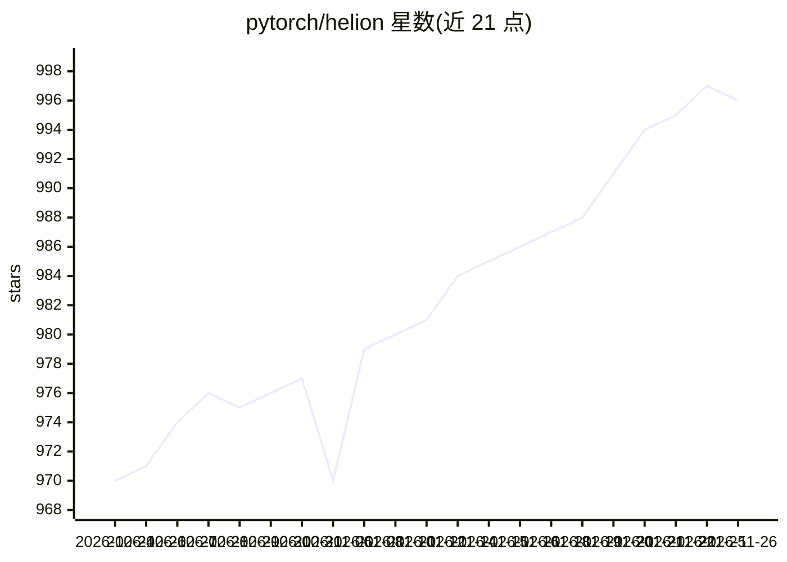

# pytorch/helion

⭐ 996 · Python · BSD-3-Clause · 推送 2026-11-25 · [GitHub](https://github.com/pytorch/helion) · 组织维护

**嵌入式 Python DSL：让 ML 开发者少写样板代码生成 GPU/TPU 内核**

Helion 是 PyTorch 官方维护的 Python 嵌入式 DSL，用于编写机器学习内核：内核以 PyTorch 算子对 tile 的操作表达算法，编译器推导配置空间并自动调优，同一内核可适配不同输入形状与硬件目标。支持 Triton（默认）、CuTe DSL、TileIR、Pallas、Gluon、Metal、FlyDSL 多个代码生成后端，覆盖 NVIDIA/AMD GPU、TPU 与 Apple GPU。自动处理张量索引、掩码、网格尺寸、循环归约与 L2 缓存优化等；首次运行触发自动调优，也可手动指定配置跳过调优。文档建议生产部署使用预调优配置，因运行时调优耗时且资源密集。

## 筛选速览

| 维度 | 判定 | 备注 |
|---|---|---|
| AI 角色 | `ai-ecosystem` | LLM/agent 周边工具 |
| 许可风险 | `permissive` | BSD-3-Clause |
| 部署形态 | `library` | 以包/库形式分发 |
| 模型依赖 | — | README 未给出锁定关系 |
| 硬件要求 | — | 无带数字的原话,不猜 |
| 安装摩擦 | `medium` | 含编译或系统依赖之一 |
| 成熟度 | — | 结构信号不足 |

## 能力要点

- 以 PyTorch 算子+tile 表达内核，编译器自动推导配置空间并自调优
- 7 个代码生成后端：Triton/CuTe/TileIR/Pallas/Gluon/Metal/FlyDSL
- 自动处理张量索引、掩码、网格尺寸、归约与 PID swizzling 等优化
- 支持手动指定 Config 跳过调优或多配置轻量评估

## 适用场景

- 为不同 GPU/TPU 硬件目标编写可移植的 ML 内核
- 用 PyTorch 熟悉语法替代手写低层内核代码
- 针对 B200/B300 等 Blackwell 硬件做内核性能调优
- 生产部署前生成预调优内核配置

## 场景标签

 · 领域:ML 系统/内核编译

## 证据(README 行号)

> L10: **Helion** is a Python-embedded domain-specific language (DSL) for
> L12: as PyTorch operations over tiles; the compiler derives a configuration
> L16: ## Backends

## 星数曲线

2026-10-24 970 → 2026-11-26 996（+26）

---
*卡片 v1 · prompt 1.4 · 生成 2026-11-26 · 置信度 high · 依据 README sha `b18bd245da97` · [字段定义](../../DATASET.md)*
