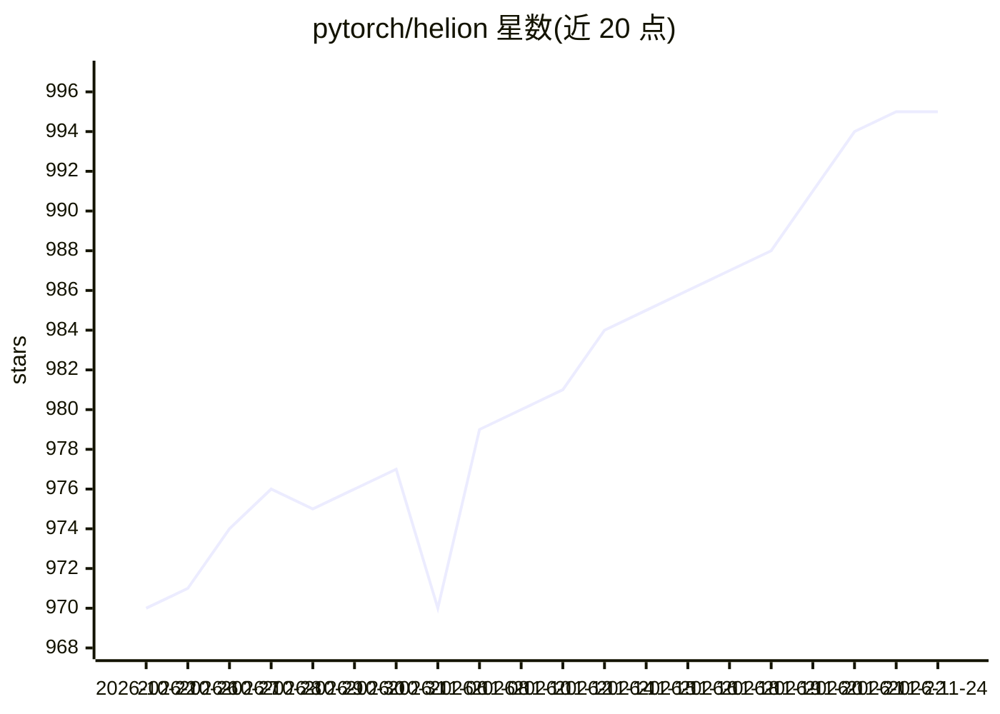

# pytorch/helion

⭐ 995 · Python · BSD-3-Clause · 推送 2026-11-22 · [GitHub](https://github.com/pytorch/helion) · 组织维护

**给 ML 开发者的 Python 内嵌 DSL：用 PyTorch 写法编写可自动调优的 GPU kernel**

Helion 是 PyTorch 官方的 Python 内嵌领域专用语言（DSL），用于编写机器学习 kernel：用户以 PyTorch 操作在 tile 上表达算法，编译器自动推导配置空间并自调优，使同一 kernel 适配不同输入形状与硬件目标。支持 Triton（默认）、TileIR、CuTe、Gluon、Pallas（TPU）、Metal、FlyDSL 等多后端，覆盖 NVIDIA Blackwell、Google TPU、Apple 与 AMD GPU。自动处理张量索引、掩码、网格尺寸、kernel 参数等；自调优耗时较长，生产部署建议使用预先调优配置。

## 筛选速览

| 维度 | 判定 | 备注 |
|---|---|---|
| AI 角色 | `ai-ecosystem` | LLM/agent 周边工具 |
| 许可风险 | `permissive` | BSD-3-Clause |
| 部署形态 | `library` | 以包/库形式分发 |
| 模型依赖 | — | README 未给出锁定关系 |
| 硬件要求 | — | 无带数字的原话,不猜 |
| 安装摩擦 | `medium` | 含编译或系统依赖之一 |
| 成熟度 | — | 结构信号不足 |

## 能力要点

- 以 @helion.kernel 装饰器用 PyTorch 操作编写 kernel，编译器自动生成配置空间并自调优
- 多后端：Triton（默认）、TileIR/CuTe/Gluon（Blackwell）、Pallas（TPU）、Metal、FlyDSL（AMD）
- 自动处理张量索引、隐式掩码、网格尺寸、循环归约与 L2 优化、warp specialization 等
- 支持显式 config 跳过自调优，并提供程序化 API 管理调优与配置

## 适用场景

- 用 PyTorch 语法编写矩阵乘、softmax、pointwise 等自定义 GPU kernel
- 为 Blackwell GPU 或 TPU 生成适配多硬件目标的 kernel
- 通过静态形状与配置复用控制自调优时间

## 场景标签

 · 领域:机器学习基础设施/编译器

## 证据(README 行号)

> L10: **Helion** is a Python-embedded domain-specific language (DSL) for
> L12: as PyTorch operations over tiles; the compiler derives a configuration
> L171: **For production deployment**, we recommend using ahead-of-time tuned configurations rather than relying on runtim

## 星数曲线

2026-10-22 970 → 2026-11-24 995（+25）

---
*卡片 v1 · prompt 1.4 · 生成 2026-11-24 · 置信度 high · 依据 README sha `14cbbd3db310` · [字段定义](../../DATASET.md)*
